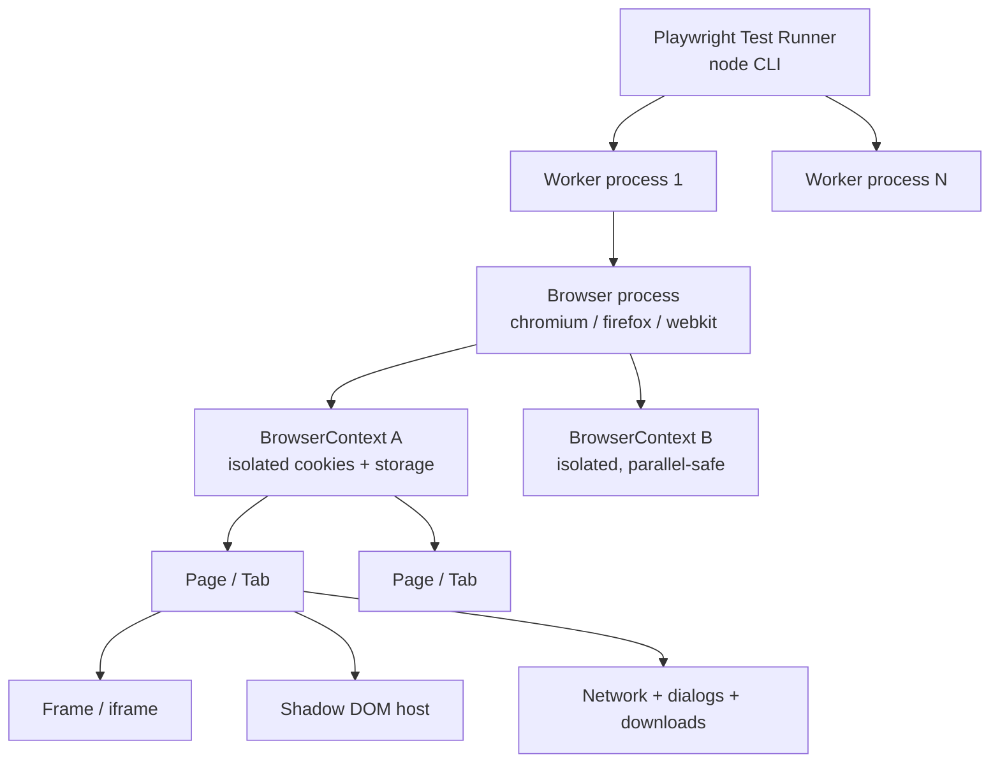
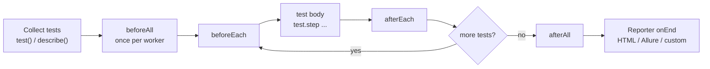
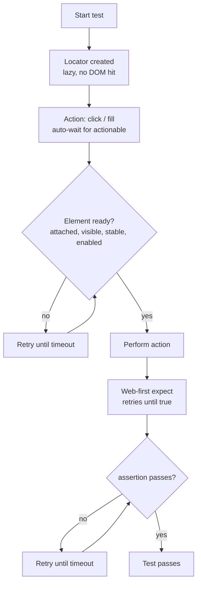

# Playwright 3x - Complete ELI5 Guide (Concepts + Scripts)

A plain-language map of **everything in this repo**, with diagrams, tables,
runnable examples pulled from the actual specs, and interview questions.

> **ELI5** = Explain Like I'm 5. Every concept starts with a one-line analogy,
> then the real API, then the repo file that proves it.

---

## How to use this guide

| Step | Read this | What you get |
|---|---|---|
| 1 | `00_INDEX.md` (this file) | The map, architecture, command cheat sheet |
| 2 | `01_Foundations.md` | Browser/context/page, annotations, hooks, locators |
| 3 | `02_Widgets_Interactions.md` | Tables, dropdowns, frames, keyboard, alerts, SVG, upload/download |
| 4 | `03_Assertions_Data_Reports.md` | Assertions, data-driven testing, sessions, reports |
| 5 | `04_Framework_Advanced.md` | POM, fixtures, custom reporter, AI, API/BDD/CI |
| 6 | `05_Interview_Scripting.md` | 50 interview Q&A + 12 coding exercises |

Each topic follows the same shape:

```
ELI5 -> Diagram -> API table -> Repo script -> Gotchas -> Interview Qs
```

---

## Repo map (what lives where)

```
LearnPlaywright3x_PlaywrightScripts/
├── playwright.config.ts        # runner settings: reporters, media, views
├── tsconfig.json               # strict TS, resolveJsonModule (JSON imports work)
├── package.json                # deps + npm scripts
├── tests/
│   ├── 01_Basics/              # BCP, contexts, test options, raw playwright
│   ├── 02_TestAnnotations/     # skip/only/fail/fixme/slow, describe
│   ├── 03_Locator_Commands/    # CSS, XPath, getByRole, referer, waitUntil
│   ├── 04_Session_Storage/     # storageState: log in once, reuse
│   ├── 05_Allure_Reporting/    # allure-playwright + custom HTML reporter
│   ├── 06_Multiple_Element_Filter/  # all(), allInnerTexts(), filter()
│   ├── 07_WebTables/           # rows/cols loops, dynamic XPath, pagination
│   ├── 08_Web_Select_Frames_Iframe/ # native + custom dropdowns
│   ├── 09_Frame_Iframe/        # frameLocator, nested iframes
│   ├── 10_Keyboard_Hover_Drag_Drop_Calender/ # keyboard, hover, DnD, context menu
│   ├── 11_JS_Alerts/           # dialog handler
│   ├── 12_Handle_SVG/          # SVG paths, maps, charts
│   ├── 13_Shadow_DOM/          # shadow-piercing locators
│   ├── 14_FileUpload/          # setInputFiles from disk + buffers
│   ├── 15_File_Download/       # download event + saveAs
│   ├── 16_Scroll_toElement/    # scrollIntoView, lazy load, expect.poll
│   ├── 17_Expect_Assertions/   # auto-retrying assertions, soft asserts
│   ├── 18_Test_hooks/          # beforeEach/afterEach, serial, tags, steps
│   ├── 19_Data_Driven_Testing/# JSON, CSV, YAML, Excel, MySQL, Faker
│   ├── 20_Page_Object_Model/   # POM classes + lazy locator proof
│   ├── 21_Fixture/             # placeholder for custom fixtures
│   ├── 22_Misc_AI_Concepts/    # placeholders: MCP, CLI, agents, migration
│   ├── 23_Advance_PW_Framework/# placeholders: API, Cucumber, AI factory, CI
│   └── Tasks/                  # 12 graded practice scripts
├── utils/
│   ├── CustomReporter.ts       # live HTML report, AI tabs, media
│   ├── stepScreenshot.ts       # attaches `step-<n>-<name>` screenshots
│   ├── selfHeal.ts             # self-healing report shape
│   └── sessionStorageTTA.ts    # one-off script to save TTA session
├── ai/
│   ├── agents/rcaAgent.ts      # failure -> root cause verdict
│   ├── agents/flakyAnalyzer.ts # build vs build flaky diff
│   └── config/providers.ts     # which LLM key is present
├── test-data/                  # shared JSON + uploads (repo convention)
├── template/template.spec.ts   # blank spec to copy
└── Notes_prompts/              # your private notes (this guide lives here)
```

---

## Master concept table

| # | Module | Core concept | Key script | One-line remember |
|---|---|---|---|---|
| 01 | Basics | Browser / Context / Page | `01_Basics/220_BCP.spec.ts` | One browser, many isolated contexts, many pages |
| 01 | Basics | Multi-user isolation | `01_Basics/221_TA.spec.ts` | Two contexts = two logged-in users |
| 01 | Basics | Context options | `01_Basics/222_Test_Options.spec.ts` | viewport, locale, timezone, geolocation, mobile |
| 02 | Annotations | skip / only / fail / fixme / slow | `02_TestAnnotations/223_TestAnnotations.spec.ts` | Annotations describe intent, not logic |
| 02 | Annotations | Grouping | `02_TestAnnotations/224_TestDescribe.spec.ts` | `describe` groups; `-g` filters |
| 03 | Locators | CSS / XPath / role | `03_Locator_Commands/225-230` | Prefer role, fall back to CSS/XPath |
| 03 | Locators | Navigation options | `03_Locator_Commands/225_LC.spec.ts` | `waitUntil`, `timeout`, `referer` |
| 04 | Storage | Session reuse | `04_Session_Storage/231_SessionStorage.ts` | Save `storageState`, skip login |
| 05 | Reporting | Allure + custom HTML | `05_Allure_Reporting/234_Media_Custom_Report.spec.ts` | `test.step` is the reporting unit |
| 06 | Multi-element | `.all()`, `.filter()` | `06_Multiple_Element_Filter/235_ME.spec.ts` | Count first, then filter, then act |
| 07 | Web tables | Cell loops + pagination | `07_WebTables/241_WebTable_Pagination.spec.ts` | Loop until row found or Next disabled |
| 08 | Dropdowns | Native + custom | `08_Web_Select_Frames_Iframe/243-245` | `<select>` uses `selectOption`, widgets use clicks |
| 09 | Frames | `frameLocator` | `09_Frame_Iframe/246_Iframe_TestCase.spec.ts` | Chain a frameLocator per nesting level |
| 10 | Input | Keyboard, hover, drag | `10_Keyboard_Hover_Drag_Drop_Calender/252_Advance_Drag_Drop.spec.ts` | Keyboard API or mouse down/move/up |
| 11 | Alerts | Dialog handler | `11_JS_Alerts/254_JS_Alerts.spec.ts` | Register `page.once('dialog')` before the click |
| 12 | SVG | Shapes, maps, charts | `12_Handle_SVG/257_SVG_Map_TC.spec.ts` | SVG nodes are DOM: target `path` with class |
| 13 | Shadow DOM | Auto-piercing | `13_Shadow_DOM/259_Shadow_DOM_TC.spec.ts` | Locators pierce open shadow roots automatically |
| 14 | Upload | `setInputFiles` | `14_FileUpload/265_FileUpload_OtherDir_TC.spec.ts` | Path or buffer; share fixtures in `test-data/uploads` |
| 15 | Download | `download` event | `15_File_Download/266_FileDownload_TC.spec.ts` | `Promise.all([waitForEvent, click])` then `saveAs` |
| 16 | Scroll | Scroll + lazy load | `16_Scroll_toElement/268_Lazy_Scroll_TC.spec.ts` | `scrollIntoViewIfNeeded` + `expect.poll` |
| 17 | Assertions | Web-first expects | `17_Expect_Assertions/271_Expect2.spec.ts` | `expect(locator)` retries; generic `expect` does not |
| 18 | Hooks | Lifecycle + serial | `18_Test_hooks/277_Tk.spec.ts` | `beforeAll` once, `beforeEach` per test |
| 19 | Data | JSON/CSV/YAML/Excel/DB/Faker | `19_Data_Driven_Testing/284-290` | Sync readers -> one test per row; async -> steps |
| 20 | POM | Page objects | `20_Page_Object_Model/292_POM.spec.ts` | Locators + actions in a class; specs stay readable |
| 21 | Fixtures | Custom setup | folder placeholder | `test.extend` gives reusable, typed setup |
| 22 | AI | MCP / CLI / agents | folder placeholders + `ai/` | AI assists authoring, not replaces assertions |
| 23 | Advanced | API / BDD / CI / factory | folder placeholders | Same runner can drive UI, API and CI gates |

---

## Architecture diagram (the one interviewers draw)



**ELI5:** the runner is the school, workers are classrooms, the browser is the
building, each context is a separate locker room, and a page is one student's desk.

### Why this matters

| Layer | Cost | Shared? | Use when |
|---|---|---|---|
| Browser | Highest | Per worker | Launch once per test by the runner |
| Context | Low | No | Reuse for login/session isolation |
| Page | Lowest | No | One tab per test step/scenario |

`tests/01_Basics/220_BCP.spec.ts` launches the browser **once**, creates a
context, then a page, and closes in reverse order.

---

## Test lifecycle (what actually runs)



---

## Your config at a glance

From `playwright.config.ts`:

| Setting | Value | Why it matters |
|---|---|---|
| `testDir` | `./tests` | Only specs under `tests/` are collected |
| `fullyParallel` | `true` | Tests in a file run in parallel across workers |
| `retries` | `2` on CI, `0` local | Hides flakes locally, shows them on CI |
| `workers` | `1` on CI | Deterministic CI; unlimited local |
| `reporter` | line + allure + custom | Three views of the same run |
| `headless` | `false` | You can watch the browser |
| `screenshot`/`video`/`trace` | all `on` | Every test has media, big disk cost |
| `viewport` | 1920x1080 | Re-applied per project (project `use` wins) |
| `projects` | chromium only | README mentions 3 browsers, config runs 1 |

> **Gotcha to call out in interviews:** config-level `use` is overridden by
> project-level `use`. That is why `devices['Desktop Chrome']` (1280x720) would
> silently shrink the viewport if the project did not repeat 1920x1080.

---

## Command cheat sheet (Windows / cmd.exe friendly)

| Goal | Command |
|---|---|
| Install deps (keep dev deps even with NODE_ENV=production) | `npm install --include=dev` |
| Install browsers | `npx playwright install` |
| Run everything | `npx playwright test` |
| Run one spec | `npx playwright test tests/07_WebTables/241_WebTable_Pagination.spec.ts` |
| Run by title | `npx playwright test -g "Login"` |
| Run by tag | `npx playwright test --grep @p1` |
| Headed / UI / debug | `--headed` / `--ui` / `--debug` |
| One browser only | `--project=chromium` |
| Repeat to find flakes | `--repeat-each=5` |
| Last failed only | `--last-failed` |
| Show HTML report | `npx playwright show-report` |
| Generate + open Allure | `npx allure generate allure-results -o allure-report --clean` then `npx allure open allure-report` |
| Record a flow | `npx playwright codegen https://example.com` |
| Inspect a trace | `npx playwright show-trace test-results/.../trace.zip` |

---

## Mental model: how a Playwright test thinks



Two ideas unlock all of Playwright:

1. **Locators are lazy.** Creating 100 of them costs microseconds; the DOM is
   queried only when you act or assert. Proof: `20_Page_Object_Model/294_heavy_page.spec.ts`.
2. **Assertions retry.** `expect(locator).toBeVisible()` polls; a raw
   `expect(await locator.isVisible()).toBe(true)` does not.

---

## Repo conventions worth copying

| Convention | Example |
|---|---|
| Data in JSON, not literals | `import orangeHRM from '../../test-data/OrangeHRM.json'` |
| Shared uploads in one folder | `test-data/uploads/sample.pdf` |
| Faker for generated data | `19_Data_Driven_Testing/290_DDT_FAKER.spec.ts` |
| `test.step` for report timings | `20_Page_Object_Model/293_cart_add_assertion.spec.ts` |
| Page objects own selector quirks | `pages/CartPage.ts` knows `data-test`, not `data-testid` |
| Notes stay local | `Notes_prompts/` is excluded from public pushes |

---

Next: **[01_Foundations.md](./01_Foundations.md)**
