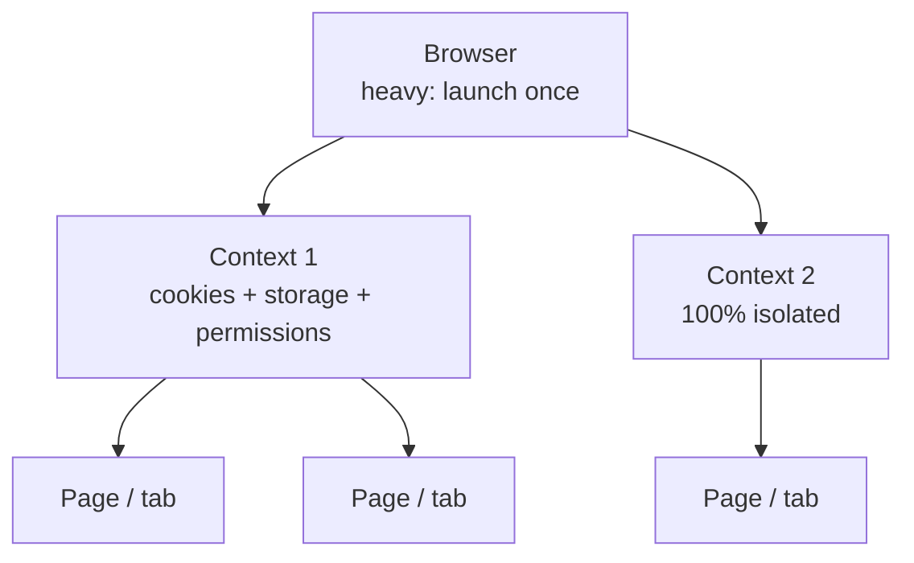
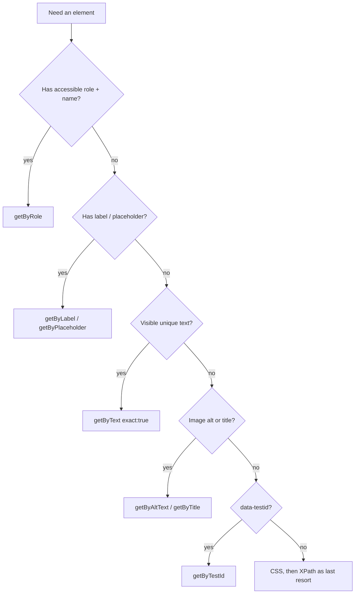
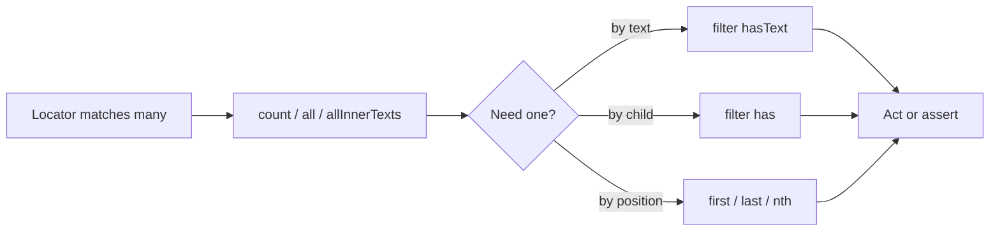
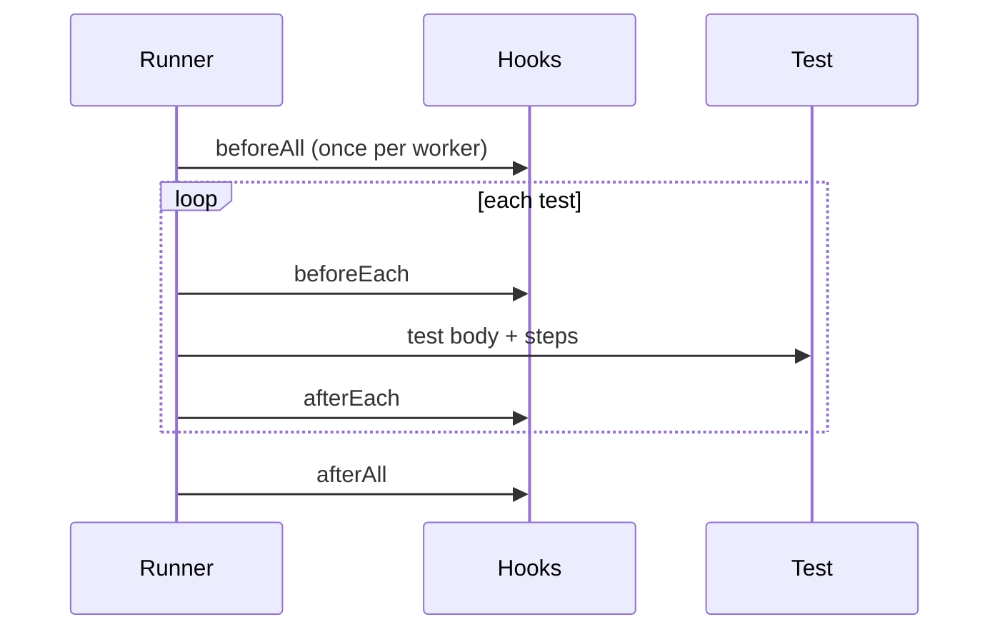

# 01 - Foundations

Covers `01_Basics`, `02_TestAnnotations`, `03_Locator_Commands`,
`06_Multiple_Element_Filter`, and `18_Test_hooks`.

---

## 1. Two ways to drive a browser

**ELI5:** `playwright` is the remote control. `@playwright/test` is the remote
control plus a referee, scoreboard, and rulebook.

| Import | What you get | Repo file |
|---|---|---|
| `import { chromium } from 'playwright'` | Library only: launch, context, page. No runner, no assertions, no reports. | `01_Basics/218_normal_pw.ts` |
| `import { test, expect } from '@playwright/test'` | Runner + fixtures + assertions + retries + reporters | every `.spec.ts` |

```ts
// library style: you own lifecycle and cleanup (01_Basics/218_normal_pw.ts)
const browser = await chromium.launch({ headless: false });
const context = await browser.newContext();
const page = await context.newPage();
await page.goto("https://example.com");
console.log("Title:", await page.title());
await page.close();
await context.close();
await browser.close();
```

```ts
// runner style: Playwright creates/closes page for you (01_Basics/216_example.spec.ts)
test('viewer', async ({ page }) => {
  await page.goto('https://playwright.dev/');
  await expect(page).toHaveTitle(/Playwright/);
});
```

**Rule:** inside `tests/`, always use `@playwright/test`. Use the raw library for
one-off scripts like `utils/sessionStorageTTA.ts`.

---

## 2. Browser -> Context -> Page (BCP)

**ELI5:** Browser is an apartment building. A context is a locked apartment with
its own cookies. A page is a person inside that apartment.



| Level | Created by | Shares cookies? | Typical lifetime |
|---|---|---|---|
| Browser | `chromium.launch()` / built-in `browser` fixture | n/a | Whole worker |
| Context | `browser.newContext()` / built-in `context` fixture | No | One test |
| Page | `context.newPage()` / built-in `page` fixture | Yes, with its context | One test |

Repo proof: `01_Basics/220_BCP.spec.ts` (launch once, create context, create page,
close in reverse) and `01_Basics/217_multiple_context.ts`.

### Why contexts exist

- Parallel tests never share cookies, so two tests cannot log each other out.
- Two users can be logged in at once: `01_Basics/221_TA.spec.ts` creates
  admin/user/guest contexts and pages in one test.
- Session state can be saved and replayed (`storageState`, see 03 guide).

---

## 3. Context options

**ELI5:** Before opening a tab, you choose the apartment's furniture: screen
size, language, timezone, location, device.

```ts
// 01_Basics/222_Test_Options.spec.ts
const context = await browser.newContext({
  viewport: { width: 1920, height: 1080 },
  locale: 'fr-FR',
  timezoneId: 'Europe/Paris',
  geolocation: { latitude: 48.8566, longitude: 2.3522 },
  permissions: ['geolocation'],
});
```

| Option | Use case |
|---|---|
| `viewport` | Responsive layout tests |
| `locale` / `timezoneId` | Date, currency, translation tests |
| `geolocation` + `permissions` | Maps / store locators |
| `isMobile`, `hasTouch`, `userAgent`, `deviceScaleFactor` | Mobile emulation |
| `extraHTTPHeaders` | Reference a partner site (`Referer`) |
| `storageState` | Start already logged in |
| `httpCredentials` | HTTP basic auth |
| `baseURL` | Short `page.goto('/login')` paths |
| `colorScheme` | Dark/light mode |

---

## 4. Test annotations

**ELI5:** Sticky notes on a test: "don't run me", "only me", "I expect to fail",
"this is slow".

| Annotation | Meaning | Result shown as |
|---|---|---|
| `test.skip()` | Never run | Skipped |
| `test.only()` | Run only this in the file | Others skipped |
| `test.fixme()` | Known broken, needs work | Skipped (flagged) |
| `test.fail()` | This *should* fail; failing = pass | Passed (expected failure) |
| `test.slow()` | Triple the timeout (30s -> 90s) | Slow |
| `test.fixme(condition, reason)` | Conditional skip | Skipped |

```ts
// 02_TestAnnotations/223_TestAnnotations.spec.ts
test.fail('cart total is wrong, BUG-451', async () => {
  expect(90).toBe(100);          // yes, failing on purpose
});

test('full regression report', async () => {
  test.slow();                    // 30s -> 90s
  console.log(test.info().timeout);
});

test('mobile layout', async ({ page, browserName }) => {
  test.fixme(browserName === 'webkit', 'Safari renders menu wrong');
});
```

**Warning:** `test.only` is banned on CI by `forbidOnly: !!process.env.CI`, so a
leftover `.only` fails the build instead of silently skipping the suite.

### Grouping

```ts
test.describe('Login Page', () => {
  test('valid credentials', ...);
  test('invalid password', ...);
});
```

Run only that group: `npx playwright test -g "Login Page"`.

---

## 5. Navigation: `page.goto` options

**ELI5:** "Go to this address, and tell me when you consider the page ready."

| `waitUntil` | Resolves when | Use for |
|---|---|---|
| `commit` | Server responded, body may be empty | Fastest, risky |
| `domcontentloaded` | HTML parsed | Most UI tests |
| `load` (default) | Images/styles loaded | Legacy pages |
| `networkidle` | No network for 500ms | Last resort, flaky on SPAs |

```ts
// 03_Locator_Commands/225_LC.spec.ts
await page.goto('https://app.thetestingacademy.com/login', {
  waitUntil: 'domcontentloaded',
  timeout: 45000,
  referer: 'https://thetestingacademy.com',
});
```

`referer` is per-navigation; `extraHTTPHeaders` is per-context
(`03_Locator_Commands/226_Refere.spec.ts`).

| API | Scope |
|---|---|
| `goto(url, { referer })` | One navigation |
| `newContext({ extraHTTPHeaders: { Referer } })` | Every navigation in that context |

---

## 6. Locators: the six semantic strategies

**ELI5:** Describe the element the way a human would ("the button named Save"),
not the way the HTML happens to be built today.



| Strategy | Example from repo | Best for |
|---|---|---|
| `getByRole` | `page.getByRole('textbox', { name: 'Email Address' })` | 90% of cases |
| `getByLabel` | `page.getByLabel('Email Address', { exact: true })` | Form fields |
| `getByPlaceholder` | `getByPlaceholder('Enter your password')` | Inputs without labels |
| `getByText` | `page.getByText('Forgotten Password').first()` | Links, headings, cells |
| `getByAltText` | `getByAltText('logo')` | Images |
| `getByTitle` | `getByTitle('Close')` | Icon buttons |
| `getByTestId` | `page.getByTestId('login-button')` | Stable app-owned hooks |
| CSS | `page.locator('#login-username')` | IDs, classes, attributes |
| XPath | `page.locator("//input[@id='email']")` | Axes: ancestor, sibling, text() |

### CSS quick table

| Goal | Selector |
|---|---|
| id | `#login-username` |
| class | `.list-group-item` |
| attribute | `[name="password"]` |
| attribute contains | `[class*="oxd-checkbox"]` |
| child | `table > tbody > tr` |
| descendant | `#login form input` |
| sibling | `h2 + p`, `h2 ~ p` |

### XPath quick table (used heavily in this repo)

| Goal | XPath |
|---|---|
| exact attribute | `//input[@id='email']` |
| contains | `//input[contains(@id,'password')]` |
| exact text | `//button[text()='Login']` |
| contains text | `//button[contains(text(),'Log')]` |
| parent | `//td[text()='x']/parent::tr` |
| preceding cell | `//td[text()='Rohan.Mehta']/preceding-sibling::td` |
| following cell | `.../following-sibling::td` |
| by aria-label | `//table[@aria-label='Employee Management System table']` |
| SVG node | `//*[name()='path' and contains(@class,'sm_state')]` |

### Strict mode

Playwright refuses to act when a locator matches more than one element:

```
Error: strict mode violation: locator('button') resolved to 4 elements
```

Fix by narrowing, not by guessing:

| Fix | When |
|---|---|
| `.filter({ hasText: 'Save' })` | Distinguish by text |
| `.filter({ has: page.locator('td') })` | Distinguish by child |
| `getByRole('button', { name: 'Save', exact: true })` | Distinguish by name |
| `.first()` / `.nth(0)` | Only if order is genuinely stable |
| Scope: `page.locator('footer').getByRole('link')` | Same text in header + footer |

Repo examples: `03_Locator_Commands/228_Project3.spec.ts` uses `.first()` for
repeated error blocks; `07_WebTables/240_TestCase.spec.ts` uses
`tr:has(td:text('Rohan.Mehta'))`.

---

## 7. Multiple elements: count, then filter

**ELI5:** You cannot click "the link" if there are 13 links. First count them,
then pick the one you mean.



| API | Returns | Cost |
|---|---|---|
| `locator.count()` | number | One round-trip |
| `locator.allInnerTexts()` | `string[]` | One batched round-trip (fast) |
| `locator.all()` | `Locator[]` | Handles, then one call per element |
| `locator.nth(i)` | Locator | Lazy |
| `locator.first()` / `.last()` | Locator | Lazy |
| `locator.filter({ hasText })` | Locator | Lazy |
| `locator.filter({ has })` | Locator | Lazy |

```ts
// 06_Multiple_Element_Filter/235_ME.spec.ts
const texts: string[] = await page.locator('a.list-group-item').allInnerTexts();
console.log(texts.length);

for (const text of texts) {
  if (text === 'Forgotten Password') {
    await page.getByText(text).first().click();
  }
}

// 236_ME.spec.ts - when you need attributes, use all()
const links = await page.locator('a.list-group-item').all();
for (const link of links) {
  console.log(await link.getAttribute('href'));
}
```

**Performance rule:** `allInnerTexts()` is one batch; looping `.nth(i).innerText()`
is N round-trips. For big tables or pagination, batch first.

---

## 8. Hooks and lifecycle

**ELI5:** `beforeAll` opens the shop; `beforeEach` unlocks the door for each
customer; `afterEach` cleans the table; `afterAll` closes the shop.



| Hook | Runs | Typical use |
|---|---|---|
| `test.beforeAll` | Once per worker | Seed DB, start server, read async data |
| `test.beforeEach` | Before every test | `page.goto`, login, set cookies |
| `test.afterEach` | After every test | Screenshot on failure, cleanup |
| `test.afterAll` | Once per worker | Teardown |

```ts
// 18_Test_hooks/277_Tk.spec.ts
test.beforeEach(async ({ page }) => {
  await page.goto('https://app.thetestingacademy.com/playwright/');
});

test.afterEach(async ({ page }, testInfo) => {
  if (testInfo.status !== testInfo.expectedStatus) {
    await page.screenshot({ path: `out/fail-${testInfo.title}.png`, fullPage: true });
  }
});
```

### Serial mode

```ts
// 278.td.spec.ts
test.describe.serial('Checkout suite - must run in order', () => {
  test('open landing', ...);
  test('search product', ...);   // skipped if the first one fails
});
```

`test.describe.configure({ mode: 'serial' })` does the same at file level.

### Tags

```ts
test('Login test @p1 @smoke', async ({ page }) => { ... });
```

Run: `npx playwright test --grep @p1`. Tags also feed the custom reporter's
priority filters.

### `test.step`

```ts
// 18_Test_hooks/276_Test.spec.ts
await test.step('open practice page', async () => {
  await page.goto('.../multiple_element_filter.html');
});
await test.step('fields are visible', async () => {
  await expect(page.getByRole('textbox', { name: 'Email Address' })).toBeVisible();
});
```

Each step becomes a timed, collapsible row in the report. The custom reporter
and `stepScreenshot` both depend on this.

---

## Interview questions - foundations

**Q1. Difference between Browser, Context and Page?**
Browser is the process; Context is an isolated session (cookies, storage,
permissions); Page is a tab. Contexts are cheap and isolated, so parallel tests
get one each.

**Q2. Why not launch a browser per test?**
Launching is the most expensive operation. The runner launches once per worker
and creates a fresh context per test, which is fast and still isolated.

**Q3. When do you use `test.fail()` vs `test.fixme()`?**
`test.fail()` asserts the test is currently failing (regression guard for a known
bug). `test.fixme()` marks it as not implemented/broken and skips it entirely.

**Q4. `test.only` is left in a spec. What happens locally vs CI?**
Locally only that test runs. On CI, `forbidOnly: true` makes the run fail so the
accidental commit cannot hide the rest of the suite.

**Q5. What is strict mode and how do you fix a violation?**
Playwright requires a locator to resolve to exactly one element. Fix by scoping
or filtering (`filter({ hasText })`, exact role names, `first()` only if stable).

**Q6. `allInnerTexts()` vs `all()`?**
`allInnerTexts()` does one batched read and returns strings. `all()` returns
locator handles so you can read attributes or act, but it costs a call per
element.

**Q7. Difference between `beforeAll` and `beforeEach`?**
`beforeAll` runs once per worker before any test in the file; `beforeEach` runs
before every test, and the `page` fixture is fresh for each.

**Q8. What does `waitUntil: 'networkidle'` do and why is it discouraged?**
It waits for 500ms of network silence. SPAs with polling/websockets may never go
idle, so it hangs or adds seconds. Prefer a web-first assertion on the element
you actually need.

**Q9. How do you emulate a French user in Paris?**
`browser.newContext({ locale: 'fr-FR', timezoneId: 'Europe/Paris' })`, plus
geolocation + permissions if location matters.

**Q10. What does `test.slow()` change?**
Triples the test timeout (30s -> 90s) and marks the result as slow. It does not
make waits slower or faster.

---

Next: **[02_Widgets_Interactions.md](./02_Widgets_Interactions.md)**
