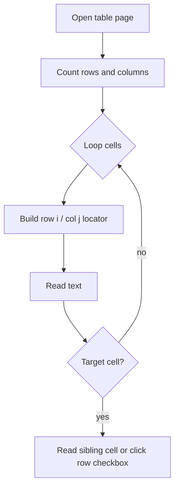
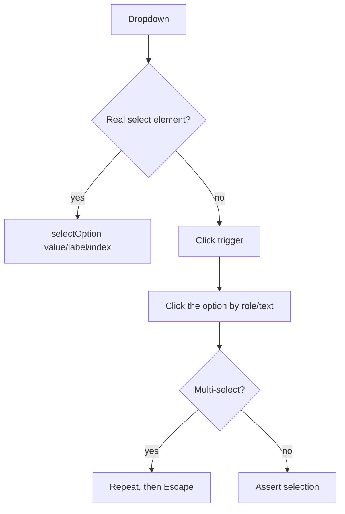
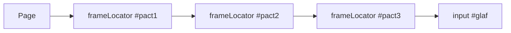
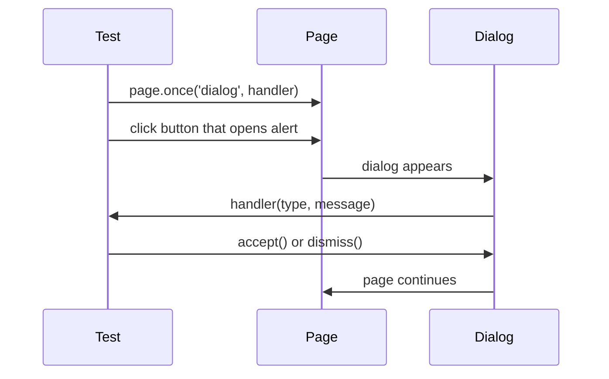
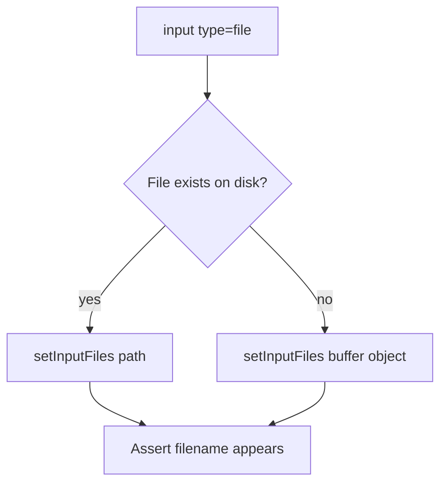
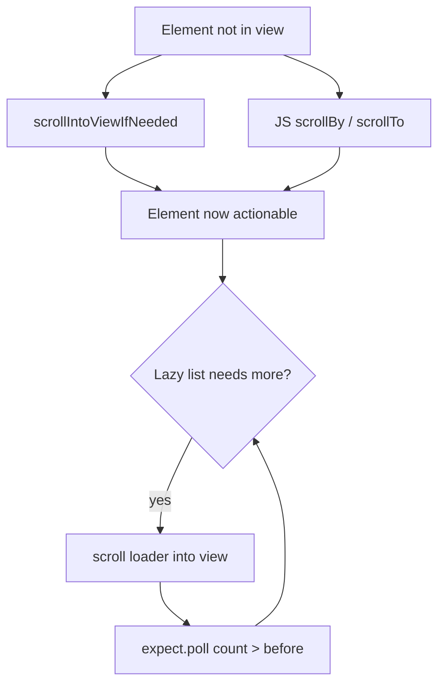

# 02 - Widgets and Interactions

Covers modules `07` through `16`: tables, dropdowns, frames, mouse/keyboard,
alerts, SVG, shadow DOM, upload, download, scroll.

---

## 7. Web tables

**ELI5:** A table is a grid of boxes. Find the box, then look left/right/up for
its neighbours.



### The three table patterns

| Pattern | Code | When |
|---|---|---|
| Row by row | `rows.nth(i).locator('td').allInnerTexts()` | Dump the whole table |
| Dynamic XPath | `//table/tbody/tr[i]/td[j]` | Act on a cell found by scanning |
| Semantic row filter | `tr:has(td:text('Rohan.Mehta'))` | You know a unique cell value |

```ts
// 07_WebTables/237_TestCase.spec.ts - dump rows
const rows = page.locator('table[summary="Sample Table"] tbody tr');
const rowCount = await rows.count();
for (let i = 0; i < rowCount - 1; i++) {
  console.log(`Row ${i + 1}:`, await rows.nth(i).locator('td').allInnerTexts());
}
```

```ts
// 07_WebTables/238_TestCase.spec.ts - find a person, read the next cell
const path = `//table[@id='customers']/tbody/tr[${i}]/td[${j}]`;
const data = await page.locator(path).innerText();
if (data.includes('Helen Bennett')) {
  const country = await page.locator(`${path}/following-sibling::td`).innerText();
  console.log(`Helen Bennett is in ${country}`);
}
```

```ts
// 07_WebTables/240_TestCase.spec.ts - click the checkbox in the matching row
await page.locator("tr:has(td:text('Rohan.Mehta'))").locator('input').first().click();
```

### Pagination: loop until the real end

```ts
// 07_WebTables/242_WebTable_Pagination.spec.ts
async function findRowByName(page: Page, name: string): Promise<Locator> {
  while (true) {
    const row = page.locator('#employees-tbody tr').filter({ hasText: name });
    if (await row.count()) return row;

    const next = page.getByTestId('next-page');
    if (await next.isDisabled()) throw new Error(`Row not found: ${name}`);
    await next.click();
  }
}
```

| End condition | How to detect |
|---|---|
| Row found | `await row.count() > 0` |
| No next page | `await next.count() === 0` |
| Last page | `await next.isDisabled()` |
| Empty grid | `await rows.count() === 0` |

**Do not** cap with `maxPages = 5`; walk until the page itself says stop.

---

## 8. Dropdowns: native vs custom

**ELI5:** Native `<select>` is a real HTML list, so Playwright can set its value.
Custom dropdowns are just divs pretending, so you must click them open.



```ts
// 08_Web_Select_Frames_Iframe/243_Select_TestCase.spec.ts
await page.selectOption('#dropdown', 'Option 2');       // by value/label
// also: selectOption('#dropdown', { label: 'Option 2' })
// also: selectOption('#dropdown', { index: 1 })
```

```ts
// 244_CustomDropDown_TestCase.spec.ts
await page.getByTestId('lang-trigger').click();
await page.getByRole('option', { name: 'JavaScript' }).click();

await page.getByTestId('experience-trigger').click();
await page.getByText('Mid-level (4-6 years)', { exact: true }).click();
```

```ts
// 245_AdvacneCustomDropDown_TestCase.spec.ts - multi + async
await page.locator('#rs-multi').click();
await page.getByText('Pytest', { exact: true }).click();
await page.getByText('JUnit', { exact: true }).click();
await page.keyboard.press('Escape');

await page.locator('#rs-async').click();
await page.getByTestId('rs-async-input').fill('de');
await expect(page.getByTestId('rs-async-menu')).toContainText('Delhi');
await page.getByRole('option', { name: 'Delhi', exact: true }).click();
```

| Dropdown type | Select with |
|---|---|
| Native `<select>` | `selectOption()` |
| ARIA listbox | `getByRole('option', { name })` |
| Div/li widget | `getByText(...).click()` |
| Searchable / async | fill the input, wait for the menu, then click |
| Multi-select chips | click each, then `Escape` to close |

---

## 9. Frames and iframes

**ELI5:** An iframe is a picture frame containing another website. You must step
inside the frame before touching anything in it.



```ts
// 09_Frame_Iframe/246_Iframe_TestCase.spec.ts
const vehicleFrame: FrameLocator = page.frameLocator('#frame-one');
await vehicleFrame.locator('#RESULT_TextField-1').fill('Hyundai i10');
await vehicleFrame.getByText('Submit registration', { exact: true }).click();
```

```ts
// 248_Nested_Iframe_TestCase.spec.ts - one locator per level
const frame1 = page.frameLocator('#pact1');
const frame2 = frame1.frameLocator('#pact2');
const frame3 = frame2.frameLocator('#pact3');
await frame3.locator('#glaf').fill('Playwright');
```

| Task | API |
|---|---|
| Enter a frame | `page.frameLocator(selector)` |
| Enter a nested frame | chain `frameLocator` on the previous frame |
| Count frames | `page.locator('//frame').count()` or `page.frames().length` |
| Locate by name | `page.frameLocator('[name="main"]')` |
| Assert inside frame | `expect(frame.locator(...))` |

**Gotcha:** a `page.locator()` never reaches inside an iframe, and a
`frameLocator()` never reaches back out. Chain from the page every time.

---

## 10. Keyboard, hover, drag and drop, context menu

**ELI5:** Sometimes clicking is not enough: you must press keys, hover to reveal
a menu, or physically drag a card.

### Keyboard

```ts
// 10_Keyboard_Hover_Drag_Drop_Calender/249_TestCase.spec.ts
await page.keyboard.press('A');
await page.keyboard.press('Shift+O');
await page.keyboard.down('Shift');
await page.keyboard.up('Shift');
```

| API | Use |
|---|---|
| `keyboard.type(text)` | Types character by character |
| `keyboard.press('Control+A')` | Key combo |
| `keyboard.down/up` | Hold a modifier across actions |
| `locator.press('Enter')` | Key on a focused element |

### Hover

```ts
// 250_Hover_TestCase.spec.ts
await page.getByText('Add-ons', { exact: true }).hover();
await page.getByText('FlyEarly', { exact: true }).click();
```

### Drag and drop

```ts
// 251_Drag_Drop.spec.ts - HTML5 drag
await page.locator('#column-a').dragTo(page.locator('#column-b'));
```

```ts
// 252_Advance_Drag_Drop.spec.ts - custom canvas/grid drag
const s = (await source.boundingBox())!;
const t = (await target.boundingBox())!;
await page.mouse.move(s.x + s.width / 2, s.y + s.height / 2);
await page.mouse.down();
await page.mouse.move(t.x + t.width / 2, t.y + t.height / 2, { steps: 10 });
await page.mouse.up();
```

| Drag type | Method |
|---|---|
| HTML5 `draggable` | `locator.dragTo(target)` |
| Custom JS drag | `mouse.move -> down -> move(steps) -> up` |
| Slider | `boundingBox` + click at percentage |
| Right-click menu | `click({ button: 'right' })` |

### Context menu

```ts
// 253_Context_Drag_Drop.spec.ts
await page.locator('span.context-menu-one').first().click({ button: 'right' });
const options = await page.locator('ul.context-menu-list span').allInnerTexts();
await page.getByText('Copy', { exact: true }).first().click();
```

**Gotcha:** custom drag needs several intermediate `move` steps; a single jump
often fails because the app listens for `dragover` between points.

---

## 11. JavaScript alerts, confirms, prompts

**ELI5:** The browser freezes the page and asks you a question. You must answer
the dialog or the page stays stuck.



```ts
// 11_JS_Alerts/254_JS_Alerts.spec.ts
page.once('dialog', async dialog => {
  console.log(dialog.type());        // alert | confirm | prompt
  console.log(dialog.message());
  expect(dialog.message()).toBe('I am a JS Alert');
  await dialog.accept();
});
await page.getByRole('button', { name: 'Click for JS Alert' }).click();
```

| Dialog | Default value | Response |
|---|---|---|
| `alert` | n/a | `accept()` |
| `confirm` | n/a | `accept()` or `dismiss()` |
| `prompt` | `defaultValue()` | `accept('typed text')` |

**Order matters:** register the handler *before* the click that triggers it, or
Playwright auto-dismisses the dialog and you miss it. Use `page.once` not `page.on`
unless you expect several dialogs.

---

## 12. SVG elements

**ELI5:** An SVG is a drawing made of DOM shapes. A circle, a bar, or a state on
a map is clickable just like a button.

```ts
// 12_Handle_SVG/256_SVG_Advance_TC.spec.ts
await page.locator('#circle-blue').click();
expect(await page.locator('#shapes-output').innerText()).toContain('Blue circle');

await page.getByRole('button', { name: /Q3 bar/ }).click();
await page.getByRole('radio', { name: '4 stars' }).click();
```

```ts
// 257_SVG_Map_TC.spec.ts - find a state path by class
const states = await page.locator(
  "//div[@id='admin1_map_inner']//*[name()='svg']//*[name()='path' and contains(@class,'sm_state')]"
).all();

for (const state of states) {
  if ((await state.getAttribute('class'))?.includes('INUP')) {
    await state.click();
  }
}
```

| Task | Locator |
|---|---|
| Generic SVG | `page.locator('svg')` |
| Shape by id | `#circle-blue` |
| Path by class | `//*[name()='path' and contains(@class,'sm_state')]` |
| Chart bar | `.bar`, then read `height` / `data-quarter` |
| Icon button | `getByRole('button')` if it has accessible name |

**Gotcha:** use `name()='path'` in XPath inside SVG. A plain `//path` can match
HTML too or fail because SVG is in a different namespace.

---

## 13. Shadow DOM

**ELI5:** Some components hide their internals behind a curtain. Playwright can
see through open curtains without extra work.

```ts
// 13_Shadow_DOM/259_Shadow_DOM_TC.spec.ts
const card = page.getByTestId('card-account-card');
await card.locator('input[name="email"]').fill('student@thetestingacademy.com');
await card.getByTestId('card-account-submit').click();
await expect(page.getByTestId('card-account-status'))
  .toContainText('student@thetestingacademy.com');

await page.getByTestId('card-inside-email').fill('pramod@thetestingacdemy.com');
```

| Scenario | Supported? |
|---|---|
| Open shadow root | Yes, CSS/role/testid pierce automatically |
| Closed shadow root | No |
| Nested shadow hosts | Yes, chain locators |
| XPath into shadow DOM | No, use CSS/role |

**Gotcha:** if a locator works in DevTools but not Playwright, confirm the root is
`open`. XPath does not cross shadow boundaries.

---

## 14. File upload

**ELI5:** You are handing the browser a file. You can hand it a real file on disk
or a fake file you build in memory.



```ts
// 260_FileUpload_TC.spec.ts - single file next to the spec
await page.locator('#file-upload').setInputFiles(path.join(__dirname, 'testdata.txt'));
```

```ts
// 262 - in-memory files
await page.locator('div.pf-v6-c-multiple-file-upload input').setInputFiles([
  { name: 'file1.jpg', mimeType: 'image/jpeg', buffer: Buffer.from('image bytes') },
  { name: 'file2.jpg', mimeType: 'image/jpeg', buffer: Buffer.from('more bytes') },
]);
```

```ts
// 265 - shared fixtures outside the test folder
const UPLOAD_DIR = path.join(__dirname, '..', '..', 'test-data', 'uploads');
const files = ['sample.pdf', 'sample.jpg', 'sample.doc'].map(f => path.join(UPLOAD_DIR, f));
await page.locator('div.pf-v6-c-multiple-file-upload input').setInputFiles(files);
```

| Need | Approach |
|---|---|
| Stable fixture | Shared `test-data/uploads/`, build path from `__dirname` |
| Generated content | Buffer object |
| Multiple | Array of strings or objects |
| Hidden input | `setInputFiles` works on hidden inputs too |
| `accept` filter | Respect allowed extensions (.doc yes, .docx may drop) |

**Avoid** `page.click` on the upload button followed by a native OS dialog. The
file chooser event or `setInputFiles` is the reliable path.

---

## 15. File download

**ELI5:** Clicking a link starts a download; you must be listening for it at the
same time, then move the file where you want it.

```ts
// 15_File_Download/266_FileDownload_TC.spec.ts
const [download] = await Promise.all([
  page.waitForEvent('download'),
  page.getByTestId('download-static').click(),
]);
await download.saveAs('./out/' + download.suggestedFilename());
```

| API | Use |
|---|---|
| `download.suggestedFilename()` | Server-provided name |
| `download.saveAs(path)` | Save to your folder |
| `download.path()` | Temp path while the test runs |
| `download.failure()` | Why it failed, or null |

**Gotcha:** never `await click()` then `await waitForEvent('download')`. The event
fires during the click, so you miss it. Use `Promise.all`.

---

## 16. Scrolling and lazy loading

**ELI5:** The page only builds items when they come into view. You must scroll to
wake them up, then wait for the list to grow.



```ts
// 16_Scroll_toElement/267_Scroll_TC.spec.ts
await page.getByTestId('deep-anchor').scrollIntoViewIfNeeded();
await page.evaluate(() => window.scrollBy(0, 1000));
await page.evaluate(() => window.scrollTo(0, document.body.scrollHeight));
await page.evaluate(() => window.scrollTo(0, 0));
```

```ts
// 268_Lazy_Scroll_TC.spec.ts
await page.getByTestId('section-lazy').scrollIntoViewIfNeeded();
const list = page.getByTestId('lazy-list').locator('li');
await expect(list).toHaveCount(10);
const initial = await list.count();

await page.getByTestId('lazy-loader').scrollIntoViewIfNeeded();
await expect.poll(async () => list.count(), { timeout: 10_000 })
  .toBeGreaterThan(initial);
```

| Need | API |
|---|---|
| Just make it clickable | `locator.scrollIntoViewIfNeeded()` |
| Page-relative scroll | `page.evaluate(() => window.scrollBy(0, 500))` |
| Jump to bottom | `window.scrollTo(0, document.body.scrollHeight)` |
| Infinite list | scroll the loader, then `expect.poll` the count |
| Infinite scroll with cap | `expect.poll` until count stops changing or target found |

**Gotcha:** at 1920x1080 the entire lazy list can already fit on screen, so
scrolling to the last item loads nothing. Scroll the *loader* at the bottom.

### AbortSignal (Playwright 1.62+)

```ts
// 269_Abort_Signal_Scroll_TC.spec.ts
const controller = new AbortController();
setTimeout(() => controller.abort(), 500);
await expect(
  page.locator('button').scrollIntoViewIfNeeded({ signal: controller.signal })
).rejects.toThrow('aborted');
```

Useful to prove a wait can be cancelled instead of burning the full timeout.

---

## Interview questions - widgets

**Q1. How do you find a row by one cell and click another cell in that row?**
`page.locator("tr:has(td:text('Rohan.Mehta'))").locator('input')`, or XPath with
`preceding-sibling` / `following-sibling` from the matched cell.

**Q2. How do you handle pagination without hard-coding a page count?**
Loop: check for the row, click Next, stop when the row appears or Next is
disabled/missing. Add a timeout or batch reads instead of capping pages.

**Q3. `selectOption` fails on a custom dropdown. Why?**
It only works on a real `<select>`. Custom widgets need click + option click.

**Q4. How do you handle a nested iframe?**
Chain frame locators: `page.frameLocator('#a').frameLocator('#b')`.

**Q5. An alert auto-accepts before your handler runs. What did you do wrong?**
The handler was registered after the click. Register `page.once('dialog')` first.

**Q6. How do you drag to a custom Kanban board?**
Use `boundingBox()` on source and target, then
`mouse.move -> down -> move({ steps: 10 }) -> up`.

**Q7. How do you locate an SVG state on a map?**
Scope to the SVG and use `//*[name()='path' and contains(@class,'sm_state')]`, then
filter by the class that identifies the state.

**Q8. Does Playwright need special handling for Shadow DOM?**
No for open roots; locators pierce automatically. Closed roots are unreachable,
and XPath does not cross the boundary.

**Q9. How do you upload a file that does not exist on disk?**
`setInputFiles({ name, mimeType, buffer: Buffer.from('...') })`.

**Q10. How do you download a file reliably?**
`Promise.all([page.waitForEvent('download'), click()])`, then `saveAs()`.

**Q11. How do you wait for an infinite-scroll list to grow?**
`expect.poll(() => items.count()).toBeGreaterThan(before)`. Do not use a fixed
`waitForTimeout`.

**Q12. Why is `scrollIntoViewIfNeeded()` usually enough?**
Because Playwright already auto-scrolls before actions; call it explicitly only
when you need to trigger lazy loading or verify visibility.

---

Next: **[03_Assertions_Data_Reports.md](./03_Assertions_Data_Reports.md)**
