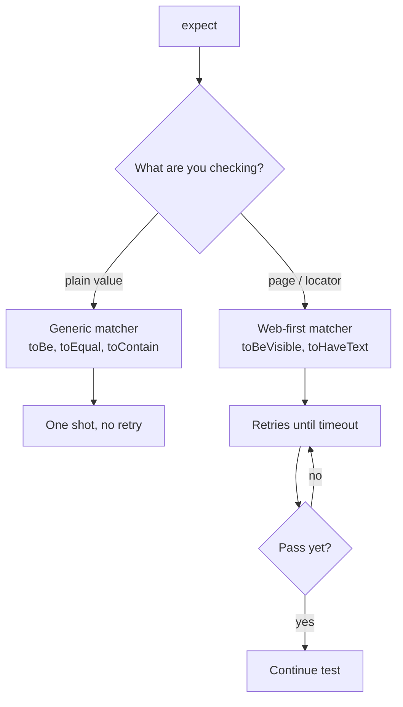
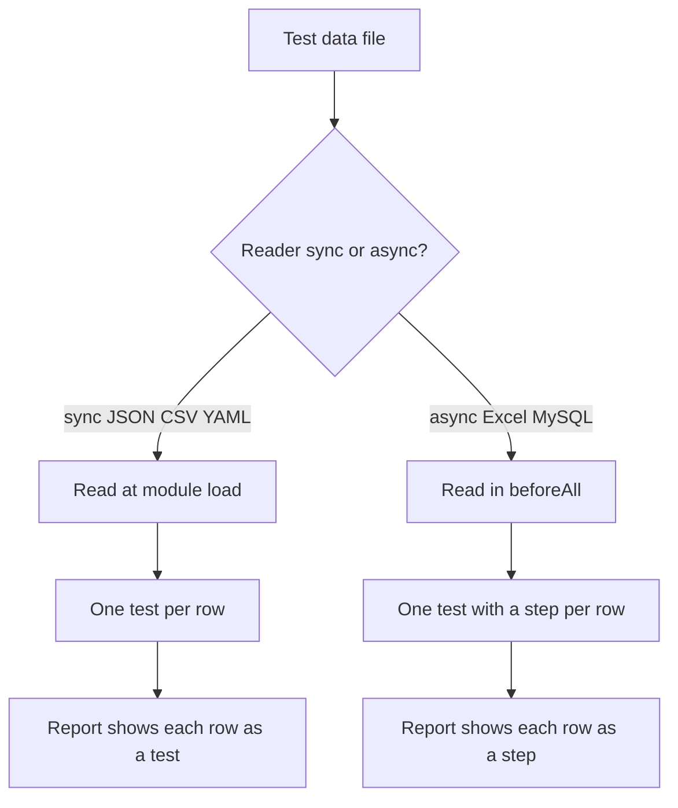
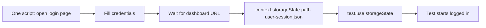

# 03 - Assertions, Data, Sessions, Reports

Covers modules `17`, `19`, `04`, `05` and the reporting pieces of `utils/`.

---

## 17. Assertions: the part that decides pass/fail

**ELI5:** `expect` is the judge. Some questions it asks once ("is 1+2 = 3?").
Some it keeps asking for a few seconds ("is the toast visible yet?").



### Generic matchers (no retry)

```ts
// 17_Expect_Assertions/270_Expect1.spec.ts
expect(1 + 2).toBe(3);
expect(ac).toBeFalsy();
expect(null).toBeNull();
expect(34).toBeGreaterThan(11);
expect([1, 2, 3]).toEqual([1, 2, 3]);
expect({ age: 20, role: 'admin' }).toEqual({ role: 'admin', age: 20 });
```

| Matcher | Checks |
|---|---|
| `toBe` | Strict equality (`Object.is`) |
| `toEqual` | Deep equality, key order ignored |
| `toContain` | String or array contains |
| `toBeTruthy` / `toBeFalsy` | Truthiness |
| `toBeNull` / `toBeUndefined` | Nullish checks |
| `toBeGreaterThan` / `LessThan` | Numbers |
| `toMatch` | Regex or substring |
| `toThrow` | Function throws |

### Web-first matchers (auto-retry)

```ts
// 271_Expect2.spec.ts
await expect(heading).toBeVisible();
await expect(heading).toContainText('filter', { timeout: 10_000 });
await expect(email).toHaveAttribute('id', 'email');
await expect(footerLinks).toHaveCount(16);
```

```ts
// 272_Expect3.spec.ts - negatives
await expect(page.locator('#error')).not.toBeVisible();
expect(await page.title()).not.toContain('error');
```

| Matcher | Works on | Checks |
|---|---|---|
| `toBeVisible` / `toBeHidden` | Locator | Visibility |
| `toBeEnabled` / `toBeDisabled` | Locator | Disabled attribute/state |
| `toBeEditable` | Locator | Can be typed into |
| `toBeChecked` | Locator | Checkbox/radio |
| `toBeFocused` | Locator | Focus |
| `toBeEmpty` | Locator | No text/value/children |
| `toHaveText` | Locator | Full text (string, regex, array) |
| `toContainText` | Locator | Substring |
| `toHaveValue` | Locator | Input value |
| `toHaveAttribute` | Locator | Attribute name/value |
| `toHaveCSS` | Locator | Computed style |
| `toHaveCount` | Locator | Number of matches |
| `toHaveClass` | Locator | Class string/regex |
| `toHaveURL` | Page | URL |
| `toHaveTitle` | Page | Title |
| `toHaveScreenshot` | Page | Visual snapshot |

### Soft assertions

```ts
// 272_Expect3.spec.ts
await expect.soft(firstName).toHaveAttribute('id', 'first-name');
await expect.soft(firstName).toBeVisible();
await expect.soft(firstName).toHaveValue('');
// ... test keeps going, all soft failures reported together
```

Use soft expects when you want a full defect list from one test. Use hard
assertions when later steps only make sense if the earlier one passed.

### `expect.poll`

```ts
// 16_Scroll_toElement/268_Lazy_Scroll_TC.spec.ts
await expect.poll(async () => list.count(), { timeout: 10_000 })
  .toBeGreaterThan(initialCount);
```

`expect.poll` retries a function and applies any matcher to its result. Perfect
for counts, API calls, or values that are not a locator.

### The classic mistake

```ts
// BAD: one shot, no retry
expect(await page.getByText('Saved').isVisible()).toBe(true);

// GOOD: retries until visible or timeout
await expect(page.getByText('Saved')).toBeVisible();
```

---

## 19. Data-driven testing (DDT)

**ELI5:** Write one test recipe; feed it different ingredients (rows of data)
instead of copying the test five times.



### Pattern A: JSON array, one test per row

```ts
// 19_Data_Driven_Testing/284_DDT_JSON_ARRAY.spec.ts
const loginData = [
  { description: 'valid', username: 'admin@gmail.com', password: 'admin123', expectedURL: /admin/ },
  { description: 'bad password', username: 'admin@x.com', password: 'wrong', expectedURL: /admin/ },
];

for (const data of loginData) {
  test(`Login with : ${data.description}`, async ({ page }) => {
    await page.locator('#email').fill(data.username);
    await page.locator('#password').fill(data.password);
    await page.getByTestId('login-button').click();
  });
}
```

### Pattern B: JSON file imported directly

```ts
// 279_DDT.spec.ts - works because tsconfig has resolveJsonModule: true
import userData from './280_Users.json';
console.log(userData.username, userData.password);
```

### Pattern C: CSV

```ts
// 285_DDT_CSV.spec.ts
const loginData = readCSV(path.join(__dirname, '/test-data/login-data.csv'));
for (const data of loginData) {
  test(`Login with : ${data.description}`, async ({ page }) => { ... });
}
```

`util/csvReader.ts` splits on newlines and commas and maps header -> cell.
Fine for simple CSVs; quoted commas/newlines need a real CSV parser.

### Pattern D: YAML (sync, best match to JSON)

```ts
// 288_DDT_YAML.spec.ts
const loginData = readYAML<LoginRow>(path.join(__dirname, 'test-data', 'login-data.yaml'));
for (const data of loginData) { test(...); }
```

YAML gives real booleans, so no `"true"` string parsing.

### Pattern E: Excel (async, one test with steps)

```ts
// 287_DDT_EXCEL.spec.ts
let rows: LoginRow[] = [];
test.beforeAll(async () => {
  rows = await readLoginDataFromExcel(XLSX_PATH);
});

test('login with every row from the spreadsheet', async ({ page }) => {
  for (const data of rows) {
    await test.step(`Login with : ${data.description}`, async () => { ... });
  }
});
```

**Why not one `test()` per row?** Playwright collects tests synchronously, and
`exceljs` is async. There is no `await` at module level. If you truly need one
test per row, pre-generate JSON in `globalSetup` and import it.

### Pattern F: MySQL

```ts
// 289_DDT_MYSQL.spec.ts
test.skip(!isDbConfigured(), 'MYSQL_HOST is not set');
test.beforeAll(async () => { rows = await readLoginDataFromDB(); });
test('login with every active row', async ({ page }) => {
  for (const row of rows) {
    await test.step(`Login with : ${row.description}`, async () => { ... });
  }
});
```

`util/dbReader.ts` uses `mysql2/promise`, parameterised queries (`?`), and
`finally { connection.end() }`.

### Pattern G: Faker (generated data)

```ts
// 290_DDT_FAKER.spec.ts
const users = faker.helpers.multiple(() => ({
  name: faker.person.fullName(),
  email: faker.internet.email().toLowerCase(),
  password: faker.internet.password({ length: 12 }),
}), { count: 5 });
```

| Data source | Reader | Sync? | Test shape |
|---|---|---|---|
| JSON array | inline / import | Sync | One test per row |
| JSON file | `import` / `fs` | Sync | One test per row |
| CSV | `csvReader.ts` | Sync | One test per row |
| YAML | `yamlReader.ts` | Sync | One test per row |
| Excel | `excelReader.ts` | Async | One test, step per row |
| MySQL | `dbReader.ts` | Async | One test, step per row |
| Faker | in-memory | Sync | One test per generated row |

### Data conventions in this repo

| Rule | Example |
|---|---|
| No hard-coded credentials/URLs in specs | `test-data/OrangeHRM.json` imported |
| Shared fixtures in one place | `test-data/uploads/` |
| Generate unique values | `faker.string.numeric(6)` for employee ID |
| Keep readers typed | `LoginRow` interface reused by YAML/Excel/DB |

---

## 04. Session storage: log in once, reuse everywhere

**ELI5:** Log in once, photocopy the keycard (cookies + localStorage), and hand
the copy to every test.



### Save the session

```ts
// 04_Session_Storage/231_SessionStorage.ts
await page.goto('https://app.wingify.com/#/login');
await page.fill('#login-username', VWO_USER);
await page.fill('#login-password', VWO_PASS);
await page.click('#js-login-btn');
await page.waitForURL(/#\/(dashboard|home)/, { timeout: 15000 });
await context.storageState({ path: './user-session.json' });
```

### Reuse the session

```ts
// 232_TestWingify.spec.ts
test.use({ storageState: './user-session.json' });

test('go directly to dashboard', async ({ page }) => {
  await page.goto('https://app.wingify.com/#/dashboard?accountId=1281316');
  await expect(page).toHaveURL(/dashboard/);
});
```

| Method | Scope | Where |
|---|---|---|
| `test.use({ storageState })` | Every test in the file | Spec top level |
| `browser.newContext({ storageState })` | One context | Script / test |
| Project `use.storageState` | Every test in project | `playwright.config.ts` |

**Security:** session files are bearer tokens. Keep them out of git
(`.gitignore`), refresh them when they expire, and never commit credentials.

**Better at scale:** a `setup` project that logs in once and writes the state,
then other projects declare `dependencies: ['setup']`. The repo uses the manual
script for learning.

Repo script variant: `utils/sessionStorageTTA.ts` saves
`tta-user-session.json`, used by `tests/Tasks/Task10_6(oct)/upload_picture.spec.ts`.

---

## 05. Reporting

**ELI5:** A test run writes a diary. Playwright's HTML report is one diary,
Allure is a prettier one, and `CustomReporter.ts` is a live dashboard.

### What this repo configures

```ts
// playwright.config.ts
reporter: [["line"], ["allure-playwright"], ["./utils/CustomReporter.ts"]],
screenshot: 'on',
video: 'on',
trace: 'on',
```

| Reporter | Output | Where |
|---|---|---|
| `line` | Terminal progress | stdout |
| `allure-playwright` | JSON results | `allure-results/` |
| Custom | Live HTML + media | `tta-report/report_<runId>.html` |
| Built-in HTML (optional) | Static report | `playwright-report/` |

### How to read the results

| Tool | Command |
|---|---|
| Built-in HTML | `npx playwright show-report` |
| Allure generate | `npx allure generate allure-results -o allure-report --clean` |
| Allure open | `npx allure open allure-report` |
| Custom report | open `tta-report/index.html` |
| Trace viewer | `npx playwright show-trace <trace.zip>` |

### Steps are the reporting unit

```ts
// 05_Allure_Reporting/234_Media_Custom_Report.spec.ts
await test.step('open the dashboard', async () => {
  await page.goto(DASHBOARD);
  await expect(page).toHaveURL(/dashboard/);
});

await testInfo.attach(`dashboard-test${n}`, {
  body: await page.screenshot({ fullPage: true }),
  contentType: 'image/png',
});
```

| Feature | Without steps | With steps |
|---|---|---|
| Report readability | One blob | Named phases |
| Timings | One duration | Per phase |
| Screenshot mapping | Test-level | Step-level (`step-N-`) |
| Failure location | Whole test | Exact phase |

### The custom reporter in one paragraph

`utils/CustomReporter.ts` implements the Reporter interface: `onBegin` creates a
run id and HTML file, `onTestBegin` tracks a test, `onStepEnd` records step
timings, `onTestEnd` copies screenshots/videos/traces and writes test data, and
`onEnd` runs optional AI analysis and finalises the report. It also writes
`reports/runs/<runId>.json` snapshots so the flaky analyzer can diff builds.

It renders five tabs: Test Results, AI Data, AI Verdict, Flaky, Self-Heal.

### Step screenshots

```ts
// utils/stepScreenshot.ts
export async function shot(page: Page, index: number, name: string) {
  await test.info().attach(`step-${index}-${name}`, {
    body: await page.screenshot(),
    contentType: 'image/png',
  });
}
```

The attachment name **must** start with `step-<index>-` (0-based) for the reporter
to pin it to that step. Any other name becomes a loose test-level attachment.

---

## Interview questions - assertions, data, reports

**Q1. Why is `await expect(locator).toBeVisible()` better than
`expect(await locator.isVisible()).toBe(true)`?**
The first retries until the timeout; the second reads a boolean once and fails
immediately on a slow page.

**Q2. When would you use `expect.soft`?**
When you want to collect multiple UI defects in one run instead of stopping at
the first failure. The test still fails at the end.

**Q3. What does `expect.poll` do?**
Repeatedly calls an async function and retries the matcher until it passes or
times out. Used for counts and non-locator values.

**Q4. How do you create one test per data row?**
Read the data synchronously at module load and loop `for (const row of data) test(...)`.
Playwright collects tests synchronously, so async readers cannot do this directly.

**Q5. Excel/DB data is async. How do you still do DDT?**
Read in `beforeAll`, then replay rows as `test.step()` inside a single test. Or
generate JSON in `globalSetup` and import it synchronously.

**Q6. How do you run only the P1 tests?**
Tag titles (`@p1`) and run `npx playwright test --grep @p1`.

**Q7. What is `storageState` and what does it contain?**
A JSON snapshot of cookies and localStorage per origin. It lets a new context
start already authenticated.

**Q8. Is it safe to commit storage state?**
No. It is a credential. Gitignore it, expire it, and generate it in CI from
secrets.

**Q9. Difference between `toHaveText` and `toContainText`?**
`toHaveText` compares the full normalised text (or an array of exact texts);
`toContainText` passes on a substring.

**Q10. What is the difference between screenshot, video and trace?**
Screenshot is one image, video is a recording, trace is a full timeline of DOM
snapshots, network, console and actions. Trace is the best debugging artifact.

**Q11. Why does the custom reporter need `step-<index>-` attachment names?**
It matches attachments to `test.step` entries by that prefix; anything else is
shown at test level rather than beside the step.

**Q12. Allure results exist but the report is empty. What do you check?**
That `allure-playwright` is in the config, the run actually wrote
`allure-results/`, and you generated with `--clean` before opening.

---

Next: **[04_Framework_Advanced.md](./04_Framework_Advanced.md)**
