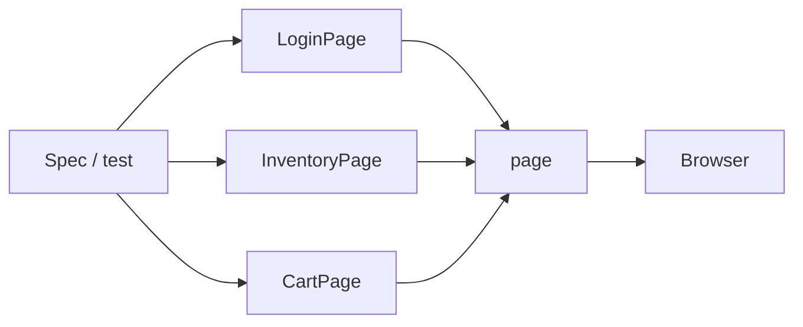
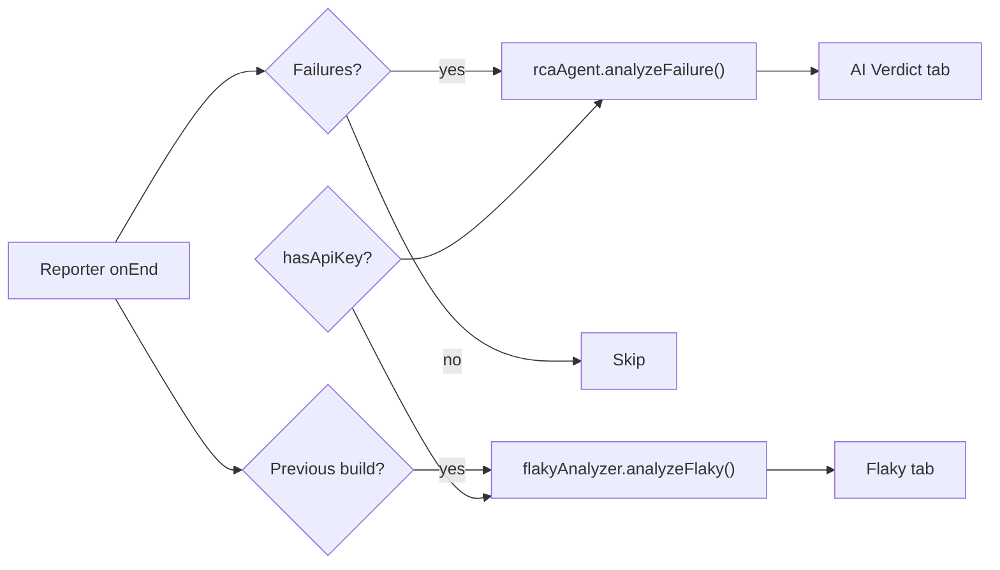
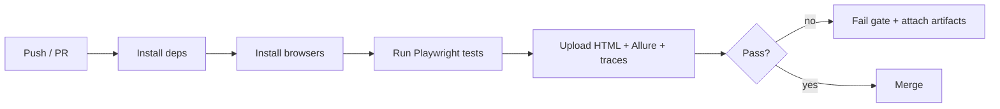

# 04 - Framework, Utilities and Advanced Topics

Covers module `20` (POM), `21` (fixtures), `22` (AI concepts), `23` (advanced
framework), plus `utils/`, `ai/`, and the graded tasks.

---

## 20. Page Object Model (POM)

**ELI5:** Instead of telling a tester every click, hand them a remote with
labelled buttons: "login", "addFirstItemToCart", "openCart".



### Without POM

```ts
// 20_Page_Object_Model/291_No_POM.spec.ts
const email = page.getByRole("textbox", { name: "Email Address" });
const password = page.getByRole("textbox", { name: "Password" }).or(page.locator("#password"));
const login = page.getByRole("button", { name: "Login to Practice Account" })
  .or(page.getByTestId("login-button"));
await email.fill('admin@gmail.com');
await password.fill('admin123');
await login.click();
```

Every spec repeats selectors. Change the UI and you edit dozens of files.

### With POM

```ts
// pages/LoginPage.ts
export class LoginPage {
  readonly page: Page;
  readonly emailInput: Locator;
  readonly passwordInput: Locator;
  readonly loginButton: Locator;

  constructor(page: Page) {
    this.page = page;
    this.emailInput = page.getByRole('textbox', { name: 'Username' });
    this.passwordInput = page.getByRole('textbox', { name: 'Password' });
    this.loginButton = page.locator('[data-test="login-button"]');
  }

  async goto() {
    await this.page.goto('https://app.thetestingacademy.com/playwright/ttacart/');
  }

  async login(username: string, password: string) {
    await this.emailInput.fill(username);
    await this.passwordInput.fill(password);
    await this.loginButton.click();
  }
}
```

```ts
// 292_POM.spec.ts
const loginPage = new LoginPage(page);
await loginPage.goto();
await loginPage.login('standard_user', 'tta_secret');
await expect(page).toHaveTitle('TTACart - Login');
```

### The 100-locator proof

`pages/HeavyPage.ts` has 100 locators and 110+ methods. The spec measures it:

```ts
// 294_heavy_page.spec.ts
const start = Date.now();
const heavy = new HeavyPage(page);
const buildMs = Date.now() - start;
expect(heavy.allLocators()).toHaveLength(100);
expect(buildMs).toBeLessThan(100);
```

**Why is it fast?** Locators are lazy. Constructing one stores a selector; no
DOM query happens. Methods live on the prototype and are shared by every
instance. Only the locator you act on touches the browser.

### POM rules that keep it maintainable

| Rule | Why |
|---|---|
| One class per page/screen | Clear ownership |
| Locators in the constructor | Single source of truth |
| Actions as methods (`login`, `openCart`) | Readable specs |
| Return values when the test needs them (`addFirstItemToCart(): string`) | Avoid duplicate reads |
| Handle app quirks inside the object (`data-test` vs `data-testid`) | Specs stay clean |
| No assertions hidden in navigation helpers | Tests should own the verdict |
| Compose with fixtures for setup | Less `new` boilerplate |

---

## 21. Fixtures

**ELI5:** A fixture is a waiter who sets the table before you sit down and
clears it after you leave, so every test starts from the same state.

> This folder is a placeholder in the repo (`.gitkeep`). Treat the code below as
> the pattern to add there.

```ts
// tests/21_Fixture/fixtures.ts
import { test as base, expect, type Page } from '@playwright/test';
import { LoginPage } from '../20_Page_Object_Model/pages/LoginPage';

type AppFixtures = {
  loginPage: LoginPage;
  loggedInPage: Page;
};

export const test = base.extend<AppFixtures>({
  loginPage: async ({ page }, use) => {
    await use(new LoginPage(page));
  },

  loggedInPage: async ({ page }, use) => {
    const loginPage = new LoginPage(page);
    await loginPage.goto();
    await loginPage.login('standard_user', 'tta_secret');
    await use(page);
  },
});

export { expect };
```

```ts
// usage
import { test, expect } from './fixtures';

test('cart is reachable when already logged in', async ({ loggedInPage }) => {
  await expect(loggedInPage).toHaveTitle('Products');
});
```

### Fixture scopes

| Scope | Runs | Use for |
|---|---|---|
| `test` (default) | Per test | Page objects, logged-in page |
| `worker` | Once per worker | DB connection, API token cache |
| `test` + `auto: true` | Per test, always | Console error guard, tracing |

```ts
// worker-scoped token
export const test = base.extend<{}, { token: string }>({
  token: [async ({}, use) => {
    const token = await fetchToken();
    await use(token);
  }, { scope: 'worker' }],
});
```

### Fixture vs hook

| Need | Use |
|---|---|
| Shared setup used by many tests, typed | Fixture |
| Setup for every test in one file only | `beforeEach` |
| Cleanup with guaranteed teardown | Fixture (`await use(x)` then cleanup) |
| Conditional setup | Fixture or conditional hook |

---

## Config deep dive

```ts
// playwright.config.ts (this repo)
export default defineConfig({
  testDir: './tests',
  fullyParallel: true,
  forbidOnly: !!process.env.CI,
  retries: process.env.CI ? 2 : 0,
  workers: process.env.CI ? 1 : undefined,
  reporter: [['line'], ['allure-playwright'], ['./utils/CustomReporter.ts']],
  use: {
    screenshot: 'on',
    video: 'on',
    trace: 'on',
    headless: false,
    viewport: { width: 1920, height: 1080 },
  },
  projects: [{ name: 'chromium', use: { ...devices['Desktop Chrome'], viewport: { width: 1920, height: 1080 } } }],
});
```

| Key | What it controls |
|---|---|
| `testDir` | Where specs are discovered |
| `fullyParallel` | Tests within a file run in parallel |
| `forbidOnly` | Fail CI if `test.only` is committed |
| `retries` | Re-run failures (on CI) |
| `workers` | Parallel processes |
| `reporter` | Where results go |
| `use.*` | Defaults for every test/project |
| `projects` | Browsers/devices and their overrides |
| `expect.timeout` | Default assertion timeout (5s) |
| `globalSetup` / `globalTeardown` | One-time setup outside workers |
| `webServer` | Start a local app before tests |
| `baseURL` | Prefix for `page.goto('/path')` |
| `dependencies` | Project ordering (e.g. auth setup before tests) |

### Multi-browser setup

```ts
projects: [
  { name: 'chromium', use: { ...devices['Desktop Chrome'] } },
  { name: 'firefox',  use: { ...devices['Desktop Firefox'] } },
  { name: 'webkit',   use: { ...devices['Desktop Safari'] } },
  { name: 'mobile',   use: { ...devices['iPhone 13'] } },
],
```

Run one: `npx playwright test --project=chromium`.

---

## Utilities (`utils/`)

### `CustomReporter.ts`

A full Reporter implementation that writes a live HTML dashboard.

| Callback | What it does |
|---|---|
| `onBegin` | Run id, output file, total test count |
| `onTestBegin` | Tracks running test and per-test media index |
| `onStepBegin` / `onStepEnd` | Records step timing and status |
| `onTestEnd` | Copies PNG/WEBM/trace, groups by file and describe, tags |
| `onEnd` | AI verdicts, flaky analysis, final HTML + history |

Extras: AI Data tab, AI Verdict tab, Flaky tab, Self-Heal tab, live auto-refresh
(`meta refresh 5`), per-step screenshots, console logs per step.

### `selfHeal.ts`

Defines the shape the reporter expects, not a healer itself:

```ts
export interface HealReport {
  failedSelector: string;
  intent: string;
  verified: HealCandidate[];
  rejected: RejectedCandidate[];
  unavailableReason?: string;
}
```

A healing fixture would try role/label/testid/text candidates, verify that one
matched and was visible, then attach the report as `self-heal` JSON.

### `stepScreenshot.ts`

`shot(page, index, name)` attaches `step-<index>-<name>`, which the reporter maps
to that step's thumbnail.

### `sessionStorageTTA.ts`

One-off login script that writes `tta-user-session.json`, used by Task10.

---

## `ai/` agents



| File | Role |
|---|---|
| `ai/agents/rcaAgent.ts` | Heuristic/LLM root cause + severity + priority + fixes |
| `ai/agents/flakyAnalyzer.ts` | Diff two builds; flaky = status flipped |
| `ai/config/providers.ts` | Detect `ANTHROPIC_API_KEY` / `OPENAI_API_KEY` / `GOOGLE_API_KEY` |

```ts
// rcaAgent.ts
if (err.includes('strict mode violation')) {
  return { rootCause: 'The locator matched more than one element.', severity: 'medium', priority: 'P2',
           fixes: ['Narrow the selector', 'Use .filter({ hasText })'] };
}
```

```ts
// flakyAnalyzer.ts
if (isFail(status) && isFail(before)) failing.push(title);
else if (isFail(status) !== isFail(before)) flaky.push(title);
```

Key idea: AI is opt-in and additive. No key -> the full HTML report still works,
AI tabs are simply empty.

---

## 22. AI concepts (folder placeholders)

The repo has empty subfolders; these are the concepts they stand for.

| Folder | Concept | What you would build |
|---|---|---|
| `01_Playwright_MCP` | Model Context Protocol | Expose Playwright tools (navigate, click, snapshot) to an LLM agent |
| `02_Playwright_CLI` | Agent-friendly CLI | Scripted browser commands an AI can call without writing specs |
| `03_Playwright_AI_Agents` | Agent loops | Plan -> act -> observe -> assert, with self-healing locators |
| `04_Selenium_To_PW_Migration` | Migration | Convert Selenium/Java page objects to Playwright TS |

Practical uses that are already wired in this repo:

| Use | File |
|---|---|
| AI root-cause verdicts | `ai/agents/rcaAgent.ts` |
| Flaky build diff | `ai/agents/flakyAnalyzer.ts` |
| Self-heal report shape | `utils/selfHeal.ts` |
| AI-generated data attachment | reporter `ai-data` tab |

**Interview framing:** AI helps author, heal and triage. Tests still need
deterministic locators and assertions; never let model output decide pass/fail.

---

## 23. Advanced framework blueprints

### API testing

```ts
import { test, expect } from '@playwright/test';

test('create and read a booking', async ({ request }) => {
  const created = await request.post('/booking', {
    data: { firstname: 'Shashi', lastname: 'HP', totalprice: 100 },
  });
  expect(created.status()).toBe(200);
  const body = await created.json();

  const fetched = await request.get(`/booking/${body.bookingid}`);
  expect(fetched.ok()).toBeTruthy();
});
```

| Need | API |
|---|---|
| Isolated request context | `request` fixture |
| Auth | `request.newContext({ extraHTTPHeaders })` / `storageState` |
| Contract check | Validate status + JSON shape |
| Combine with UI | Log in via API, reuse cookies in the browser |

### Cucumber BDD

```gherkin
Feature: Login
  Scenario: valid credentials
    Given I open the login page
    When I log in as "standard_user"
    Then I see the products page
```

```ts
// step definition delegates to the same page objects
When('I log in as {string}', async function (user: string) {
  await this.loginPage.login(user, 'tta_secret');
});
```

Rule: feature files describe behaviour; page objects do the work; do not
duplicate selectors in step definitions.

### AI agent factory

Concept: one factory produces agents per task (write test, heal selector,
analyse failure), each with a tool list, guardrails, and a structured output
schema. The reporter already consumes such structured output (RCA verdict,
heal report).

### CI/CD pipeline



| CI concern | Answer |
|---|---|
| Install with prod NODE_ENV | `npm install --include=dev` |
| Browsers | `npx playwright install --with-deps` |
| Determinism | `workers: 1`, `retries: 2` |
| Artifacts | traces, videos, reports |
| Sharding | `--shard=1/3` |
| Flake detection | `--repeat-each=5` or flaky analyzer |

---

## Tasks index (what each graded script practices)

| Task | File | Skills |
|---|---|---|
| 01 | `Task01_15(sep)AutomateLogin.spec.ts` | goto, click, fill, heading assertion |
| 02 | `Task02_17(sep).spec.ts` | XPath, attribute contains, checkbox, URL assert |
| 03 | `Task03_24(sep).spec.ts` | Table loop, `preceding-sibling`, dynamic XPath |
| 04 | `Task04_26(sep-01).spec.ts` | Faker + JSON config, CRUD flow, row locator, overlay click |
| 05 | `Task05_26(sep-02).spec.ts` | Pagination loop, batched reads, long timeout |
| 06 | `Task06_29(sep).spec.ts` | Full form: checkbox, radio, select, date, JSON output |
| 07 | `Task07_1(oct).spec.ts` | Hover menu, `toMatchObject` on JSON |
| 08 | `Task08_1(oct).spec.ts` | Table sum, currency parsing, numeric assertion |
| 09 | `Task09_6(oct).spec.ts` | SelectorHub inputs, role + id mix |
| 10 | `Task10_6(oct)/upload_picture.spec.ts` | Session state, upload, `waitForResponse`, API status |
| 11 | `Task11_10(oct).spec.ts` | Deep assertion suite: text arrays, hrefs, toast, details |
| 12 | `Task12_10(oct).spec.ts` | Steps + CSS assertion + page title |

### Task highlights worth showing in an interview

**Task04 - dynamic data + a real overlay problem**

```ts
const id = faker.string.numeric(6);
const row = page.getByRole('row', { name: new RegExp(id) });
const idInput = page.locator('//label[text()="Employee Id"]/following::input').first();

// oxd overlays a visible icon over the real checkbox input
await row.locator("//i[contains(@class,'oxd-checkbox-input-icon')]").click();
```

**Task05 - pagination until the grid is empty, no max page cap**

```ts
while (true) {
  const names = await products.allInnerTexts();
  if (names.length === 0) break;
  await nextButton.click();
}
```

**Task08 - read a money column and assert the total**

```ts
const amount = Number(text.replace(/[^0-9.-]/g, ''));
total += amount;
expect(Number(total.toFixed(2))).toBe(1996.22);
```

**Task10 - upload plus API response assertions**

```ts
const uploadPost = page.waitForResponse(r => r.url().includes('/api/storage/avatars/upload'));
await page.getByText('Upload Photo').setInputFiles('./shashi.jpg');
const uploaded = await uploadPost;
expect(uploaded.status()).toBe(200);
```

**Task12 - assertion quality**

```ts
await expect(loginButton).toHaveCSS('background-color', 'rgb(16, 163, 127)');
```

---

## Common errors and fixes

| Error | Real cause | Fix |
|---|---|---|
| `strict mode violation` | Locator matched many | Scope, filter, exact role name |
| `Timeout waiting for locator` | Wrong selector or element never rendered | Inspect trace, check frame/shadow, assert the precondition |
| `Element is not visible` | Hidden by CSS/overlay | Wait for the overlay to close; click the real target |
| `Element intercepts pointer events` | Custom checkbox/overlay | Click the visible icon or use `force: true` only as last resort |
| `frame.evaluate: Target closed` | Frame navigated/reloaded | Re-resolve frame locator after navigation |
| `dialog` auto-dismissed | Handler registered too late | Register `page.once('dialog')` before the click |
| Download never fires | Waited after click | `Promise.all([waitForEvent, click])` |
| Tests pass alone, fail together | Shared state/account | Use contexts, unique data (Faker), no global mutable state |
| Tests fail only on CI | Timing/slower machine | Web-first assertions, retries, trace on failure, no fixed sleeps |
| Session expired | storageState stale | Regenerate the state in setup |

---

## Interview questions - framework

**Q1. What problem does POM solve?**
Duplicated selectors and unreadable specs. Locators and actions live in one
class per page, so a UI change is a one-file edit.

**Q2. Why is a 100-locator page object still fast?**
Locators are lazy: creation stores a selector and does not query the DOM. Only
the locator you act on hits the browser.

**Q3. Fixture vs `beforeEach`?**
Fixtures are typed, composable, injectable, and have guaranteed teardown. Hooks
are simpler and file-scoped. Use fixtures for shared setup.

**Q4. How do you make one test depend on another's login?**
Do not chain tests. Use a setup project/dependency that writes storage state, or
a fixture that logs in per test.

**Q5. What does `fullyParallel` change?**
Tests within a single file can run in different workers. Without it, tests in a
file run in order within one worker.

**Q6. Why would `test.describe.serial` be dangerous?**
One failure skips the rest, and it prevents parallelism. Use it only for
genuinely ordered flows.

**Q7. What is the difference between `globalSetup` and `beforeAll`?**
`globalSetup` runs once before all workers; `beforeAll` runs once per worker.

**Q8. Where should assertions live in a POM design?**
In the test, not hidden inside navigation methods. Page objects expose state and
actions; tests decide what correct means.

**Q9. How does the custom reporter know which screenshot belongs to which step?**
The attachment name starts with `step-<index>-`, and the reporter maps that index
to the recorded `test.step` order.

**Q10. What happens to AI features when no API key is set?**
`hasApiKey()` returns false, RCA and flaky summaries are skipped, and the normal
HTML report is still generated.

**Q11. How would you shard a large suite in CI?**
`npx playwright test --shard=1/3` per job, then merge reports/artifacts.

**Q12. How do you test an API and a UI in one flow?**
Use the `request` fixture to seed/authenticate, then pass cookies or storage
state into the browser context.

---

Next: **[05_Interview_Scripting.md](./05_Interview_Scripting.md)**
