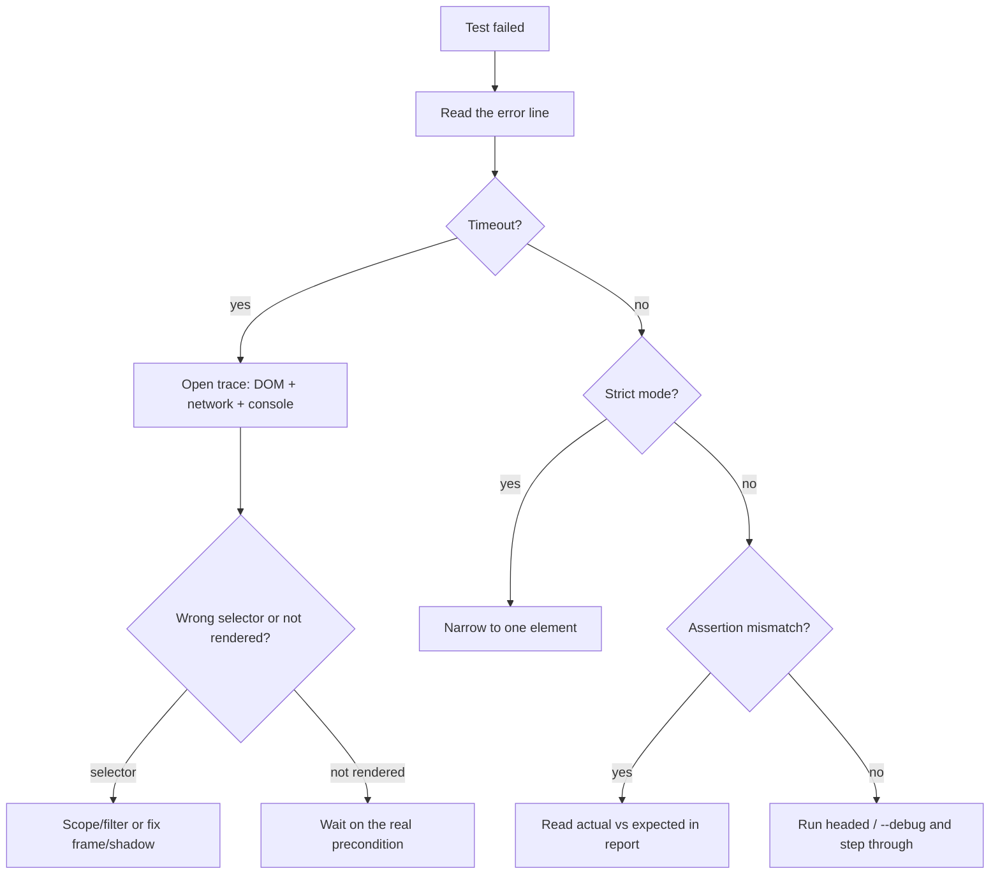

# 05 - Interview Bank and Scripting Exercises

Two parts:

1. **50 interview questions** with short, speakable answers.
2. **12 scripting exercises** with solutions modelled on this repo.

---

## Part A - Interview questions

### A1. Fundamentals (1-10)

**1. What is Playwright?**
A cross-browser end-to-end testing framework by Microsoft. It drives Chromium,
Firefox and WebKit through a single API, with auto-waiting, web-first
assertions, tracing and parallel workers.

**2. What are the advantages over Selenium?**
Built-in auto-wait and retries, isolated browser contexts instead of shared
profiles, one API for three engines, built-in runner/reporters/tracing, and no
driver binaries to manage.

**3. Explain Browser, Context, Page.**
Browser = process; Context = isolated session with its own cookies/storage;
Page = a tab in that context. One browser can host many contexts.

**4. Why is context isolation important for parallel tests?**
Tests run concurrently. If they shared cookies, one test's login/logout would
break another. Each test gets a fresh context by default.

**5. What are Playwright's auto-waiting rules?**
Before an action, it waits for the element to be attached, visible, stable (not
animating), enabled, and able to receive events. Assertions retry separately.

**6. Is Playwright only for UI testing?**
No. The `request` fixture does API testing, and the same runner can drive API,
UI, and hybrid flows.

**7. What browsers does Playwright support?**
Chromium, Firefox and WebKit (the engine behind Safari). Browsers ship with
Playwright, not the OS.

**8. How do you run one test, one file, one tag?**
`-g "title"`, a file path, and `--grep @tag`.

**9. Headless vs headed?**
Headless is faster and CI-friendly; headed is for watching/debugging. Set in
config or `--headed`.

**10. What is the difference between a worker and a shard?**
A worker is a parallel process on one machine. A shard is a slice of the suite
sent to a separate CI machine (`--shard=1/3`).

### A2. Locators (11-20)

**11. Preferred locator strategy?**
`getByRole` with an accessible name, because it mirrors what users and screen
readers see. Then label/placeholder/text/testid; CSS/XPath last.

**12. What is strict mode?**
A locator must resolve to exactly one element. Multiple matches throw instead of
silently clicking the first one.

**13. How do you fix a strict mode violation?**
Scope (`footer.getByRole(...)`), filter (`filter({ hasText })`), use an exact
accessible name, or `first()` only when order is stable.

**14. `first()` vs `nth(0)`?**
Both select positionally; `first()` reads better and handles empty sets
similarly. Neither is robust if the order changes.

**15. CSS vs XPath: when do you use XPath?**
Axes (preceding/following sibling, ancestor), text matching, and SVG nodes
(`name()='path'`). Prefer CSS/role for normal elements.

**16. How do you locate an element by partial attribute?**
CSS `[class*="oxd-checkbox"]` or XPath `//*[contains(@class,'oxd-checkbox')]`.

**17. How do you locate a button that has only an icon?**
Give it an accessible name in the app, or use `getByTestId`, `getByTitle`, or
`getByRole('button', { name: 'Close' })` if aria-label exists.

**18. How do you find a row and then a cell in it?**
`page.locator('tr:has(td:text("Name"))').locator('input')`, or XPath
`//td[text()='Name']/following-sibling::td`.

**19. What is `locator.filter({ hasText })`?**
It narrows a multi-match locator to those containing the text, without adding a
new full selector.

**20. Why avoid long CSS chains?**
They break on markup refactors and are hard to read. Scope with roles and
labels instead.

### A3. Waits and assertions (21-28)

**21. Why is `waitForTimeout` discouraged?**
It makes tests slow and flaky: too short fails, too long wastes time. Wait for a
condition with a web-first assertion instead.

**22. Difference: `expect(value)` vs `await expect(locator)`?**
The locator form retries until timeout. The value form evaluates once.

**23. How do you wait for a URL change?**
`await expect(page).toHaveURL(/dashboard/)` or `page.waitForURL(/.../)`.

**24. How do you wait for a network response?**
`page.waitForResponse(r => r.url().includes('/api/'))`, often inside
`Promise.all` with the click that triggers it.

**25. What is `expect.poll`?**
A retrying assertion on a function result, for counts or values that are not
locators.

**26. When do you increase a timeout?**
Only when the operation is genuinely long (large downloads, slow reports). Prefer
fixing the wait condition first.

**27. How do you assert a list of texts?**
`await expect(items).toHaveText(['A', 'B', 'C'])` compares all items in order.

**28. How do you check an element is gone?**
`await expect(locator).toHaveCount(0)` or `.not.toBeVisible()`.

### A4. Architecture and config (29-35)

**29. What does `fullyParallel: true` do?**
Allows tests in the same file to run in different workers. Without it, tests in a
file run in order in one worker.

**30. What is `test.use()`?**
Overrides fixtures/options for a file or describe block, e.g.
`test.use({ storageState })`.

**31. How does `storageState` work?**
It saves cookies and localStorage to JSON; a new context loads it and starts
authenticated.

**32. How do you run tests across browsers?**
Define projects in config and run all, or `--project=chromium`.

**33. Why does my project-level viewport override the global one?**
Project `use` merges over global `use`. The project wins (this repo repeats
1920x1080 for exactly that reason).

**34. What is `baseURL` for?**
Short relative navigation: `page.goto('/login')`, plus relative API paths.

**35. What is `webServer` in config?**
It starts the app (dev server) before tests and stops it after, so CI can run
without manual setup.

### A5. Data, API, reporting (36-43)

**36. How do you do data-driven testing in Playwright?**
Read data and loop `test()` calls. Sync readers (JSON/CSV/YAML) work at collection
time; async readers (Excel/DB) are loaded in `beforeAll` and replayed as steps.

**37. How do you generate unique test data?**
`@faker-js/faker`, e.g. `faker.string.numeric(6)` or `faker.internet.email()`.

**38. Where should test data live?**
In `test-data/` as JSON (this repo's convention), imported via
`resolveJsonModule`, not hard-coded in specs or scattered `.env` files.

**39. How do you upload a file?**
`setInputFiles(path)` or `setInputFiles({ name, mimeType, buffer })`.

**40. How do you download a file?**
`Promise.all([page.waitForEvent('download'), click()])`, then `saveAs()`.

**41. How do you test an API endpoint?**
Use the `request` fixture: `request.get/post`, assert status and JSON shape.

**42. How do you debug a failed CI run?**
Open the trace (`show-trace`), read the error step, inspect DOM snapshot, network
and console, then fix the wait or selector. Traces are the primary artifact.

**43. What belongs in an HTML report?**
Status, duration, steps, error + stack, screenshots, video, trace, tags, and
environment metadata.

### A6. Framework and CI (44-50)

**44. What is the Page Object Model?**
A class per page holding locators and actions, so tests read like business steps
and selectors live in one place.

**45. Why are locators in a POM safe to build eagerly?**
Locators are lazy. Construction records a selector; only actions/assertions query
the DOM.

**46. Fixture vs hook?**
Fixtures are typed, composable and injectable with guaranteed teardown. Hooks are
simpler file-level setup.

**47. How do you handle flaky tests?**
Identify with `--repeat-each`, fix the root cause (bad wait, shared data,
animation), use retries only as a safety net, and diff builds with the flaky
analyzer.

**48. What is the difference between retries and a fixed sleep?**
Retries re-run the whole test after failure; a sleep always burns time whether or
not the condition is met.

**49. How do you keep CI fast?**
Parallel workers, sharding, one login via storage state, API setup instead of UI
setup, and traces/videos only on failure.

**50. How do you decide between UI and API setup?**
Use API for preconditions (create user, seed cart) because it is faster and more
stable; use UI for the behaviour under test.

---

## Rapid-fire one-liners

| Question | Answer |
|---|---|
| Default assertion timeout | 5 seconds (`expect.timeout`) |
| Default test timeout | 30 seconds (`test.slow()` -> 90s) |
| Default action timeout | No separate default; bounded by test timeout |
| Close order | page -> context -> browser |
| Save session | `context.storageState({ path })` |
| Load session | `test.use({ storageState })` |
| Native dropdown | `selectOption()` |
| Iframe | `frameLocator()` |
| Alert | `page.once('dialog', d => d.accept())` |
| Upload | `setInputFiles()` |
| Download | `waitForEvent('download')` |
| Shadow DOM | Auto-pierced (open roots) |
| API client | `request` fixture |
| Test tags | `@smoke` + `--grep` |
| Trace viewer | `npx playwright show-trace trace.zip` |
| Codegen | `npx playwright codegen <url>` |

---

## Part B - Scripting exercises

Try each in `tests/Tasks/` or a scratch spec. Solutions use this repo's style:
XPath where it is clearer, JSON data, web-first assertions, no fixed sleeps.

### Exercise 1 - Login and assert

**Task:** Open `https://katalon-demo-cura.herokuapp.com/`, log in with
`John Doe` / `ThisIsNotAPassword`, assert the Make Appointment heading.

```ts
test('login lands on Make Appointment', async ({ page }) => {
  await page.goto('https://katalon-demo-cura.herokuapp.com/');
  await page.locator('#btn-make-appointment').click();
  await page.locator('#txt-username').fill('John Doe');
  await page.locator('#txt-password').fill('ThisIsNotAPassword');
  await page.locator('#btn-login').click();
  await expect(page.getByRole('heading', { name: 'Make Appointment' })).toBeVisible();
});
```

### Exercise 2 - Table cell + sibling

**Task:** In `awesomeqa.com/webtable.html`, find `Helen Bennett` and print her
country.

```ts
test('find Helen Bennett country', async ({ page }) => {
  await page.goto('https://awesomeqa.com/webtable.html');
  const rows = await page.locator("//table[@id='customers']/tbody/tr").count();

  for (let i = 2; i <= rows; i++) {
    const rowText = await page.locator(`//table[@id='customers']/tbody/tr[${i}]`).innerText();
    if (rowText.includes('Helen Bennett')) {
      const country = await page.locator(
        `//table[@id='customers']/tbody/tr[${i}]/td[3]`
      ).innerText();
      expect(country).toBe('UK');
    }
  }
});
```

### Exercise 3 - Pagination until found

**Task:** Search `Luca Greco` across pages and print email + country.

```ts
test('find an employee across pages', async ({ page }) => {
  await page.goto('https://app.thetestingacademy.com/playwright/tables/webtable');
  const name = 'Luca Greco';

  while (true) {
    const row = page.locator('#employees-tbody tr').filter({ hasText: name });
    if (await row.count()) {
      const email = await row.locator('td[data-col="email"]').innerText();
      const country = await row.locator('td[data-col="country"]').innerText();
      console.log(email, country);
      break;
    }
    const next = page.getByTestId('next-page');
    if (await next.isDisabled()) throw new Error('Row not found');
    await next.click();
  }
});
```

### Exercise 4 - Custom dropdown

**Task:** Pick `JavaScript` and `Mid-level (4-6 years)`.

```ts
test('custom dropdowns', async ({ page }) => {
  await page.goto('https://app.thetestingacademy.com/playwright/tables/dropdowns');
  await page.getByTestId('lang-trigger').click();
  await page.getByRole('option', { name: 'JavaScript' }).click();
  await page.getByTestId('experience-trigger').click();
  await page.getByText('Mid-level (4-6 years)', { exact: true }).click();
});
```

### Exercise 5 - Iframe form

**Task:** Fill the vehicle registration form inside `#frame-one` and read the
output.

```ts
test('iframe registration', async ({ page }) => {
  await page.goto('https://app.thetestingacademy.com/playwright/frames/');
  const f = page.frameLocator('#frame-one');
  await f.locator('#RESULT_TextField-1').fill('Hyundai i10');
  await f.locator('#RESULT_TextField-2').fill('Pramod Dutta');
  await f.locator('#RESULT_TextField-3').fill('2012');
  await f.locator('#RESULT_RadioButton-1').selectOption('Hatchback');
  await f.getByText('Submit registration', { exact: true }).click();
  await expect(f.locator('#vehicle-output')).toContainText('Hyundai');
});
```

### Exercise 6 - Confirm dialog

**Task:** Accept the confirm and assert `You clicked: Ok`.

```ts
test('confirm dialog', async ({ page }) => {
  await page.goto('https://the-internet.herokuapp.com/javascript_alerts');
  page.once('dialog', async d => {
    expect(d.type()).toBe('confirm');
    await d.accept();
  });
  await page.getByRole('button', { name: 'Click for JS Confirm' }).click();
  await expect(page.locator('#result')).toHaveText('You clicked: Ok');
});
```

### Exercise 7 - Upload from shared fixtures

**Task:** Upload `sample.pdf`, `sample.jpg`, `sample.doc` from
`test-data/uploads`.

```ts
test('upload shared fixtures', async ({ page }) => {
  await page.goto('https://www.patternfly.org/components/file-upload/multiple-file-upload/');
  const dir = path.join(__dirname, '..', '..', 'test-data', 'uploads');
  await page.locator('div.pf-v6-c-multiple-file-upload input')
    .setInputFiles(['sample.pdf', 'sample.jpg', 'sample.doc'].map(f => path.join(dir, f)));
  const area = page.locator('div.pf-v6-c-multiple-file-upload');
  await expect(area).toContainText('sample.pdf');
  await expect(area).toContainText('sample.doc');
});
```

### Exercise 8 - Download and save

**Task:** Download the static file and save it under `out/`.

```ts
test('download a file', async ({ page }) => {
  await page.goto('https://app.thetestingacademy.com/playwright/widgets/upload-download');
  const [download] = await Promise.all([
    page.waitForEvent('download'),
    page.getByTestId('download-static').click(),
  ]);
  await download.saveAs(`./out/${download.suggestedFilename()}`);
  expect(download.suggestedFilename()).toBeTruthy();
});
```

### Exercise 9 - Lazy list grows

**Task:** Prove the lazy list loads more than its initial 10 items.

```ts
test('lazy list grows', async ({ page }) => {
  await page.goto('https://app.thetestingacademy.com/playwright/widgets/scroll');
  await page.getByTestId('section-lazy').scrollIntoViewIfNeeded();
  const items = page.getByTestId('lazy-list').locator('li');
  await expect(items).toHaveCount(10);
  const before = await items.count();

  await page.getByTestId('lazy-loader').scrollIntoViewIfNeeded();
  await expect.poll(() => items.count(), { timeout: 10_000 }).toBeGreaterThan(before);
});
```

### Exercise 10 - JSON data-driven login

**Task:** One test per row from a JSON array, asserting the URL.

```ts
const rows = [
  { d: 'valid', email: 'admin@gmail.com', pass: 'admin123', url: /login-success/ },
  { d: 'empty email', email: '', pass: 'admin123', url: /multiple_element_filter/ },
  { d: 'empty password', email: 'a@b.com', pass: '', url: /multiple_element_filter/ },
];

for (const row of rows) {
  test(`login: ${row.d}`, async ({ page }) => {
    await page.goto('https://app.thetestingacademy.com/playwright/multiple_element_filter');
    await page.getByRole('textbox', { name: 'Email Address' }).fill(row.email);
    await page.getByRole('textbox', { name: 'Password' }).fill(row.pass);
    await page.getByTestId('login-button').click();
    await expect(page).toHaveURL(row.url);
  });
}
```

### Exercise 11 - Refactor to POM

**Task:** Move the exercise 1 selectors into a `CuraLoginPage` class.

```ts
export class CuraLoginPage {
  constructor(private page: Page) {}

  async goto() {
    await this.page.goto('https://katalon-demo-cura.herokuapp.com/');
    await this.page.locator('#btn-make-appointment').click();
  }

  async login(user: string, pass: string) {
    await this.page.locator('#txt-username').fill(user);
    await this.page.locator('#txt-password').fill(pass);
    await this.page.locator('#btn-login').click();
  }
}
```

### Exercise 12 - API + UI hybrid

**Task:** Create data through the API, then verify it through the UI.

```ts
test('seeded data is visible in the UI', async ({ request, page }) => {
  const created = await request.post('/api/items', { data: { name: 'Laptop' } });
  expect(created.status()).toBe(201);

  await page.goto('/items');
  await expect(page.getByText('Laptop')).toBeVisible();
});
```

---

## How to explain any script in an interview (60-second template)

1. **Setup:** "This spec opens X and uses a page object / JSON data."
2. **Locators:** "I use role-based locators for stable elements and XPath for the
   table axes."
3. **Flow:** "Open, log in, perform the business action, assert the outcome."
4. **Waits:** "No sleeps; web-first assertions retry until the UI settles."
5. **Data:** "Credentials and URLs come from `test-data/`, unique values from
   Faker."
6. **Reporting:** "Steps are named, so the report shows timing and screenshots per
   phase."
7. **Failure story:** "If it fails on CI, I open the trace and inspect the failing
   step, DOM snapshot and network."

---

## Debug playbook



| Symptom | First check |
|---|---|
| Passes locally, fails CI | Timeouts, viewport, data collisions, animations |
| Passes alone, fails in suite | Shared account/state, use unique data + contexts |
| Selector works in DevTools | Frame, shadow root, or hidden duplicate |
| Click does nothing | Overlay intercepting; click the visible layer |
| Value never appears | Wrong endpoint/state; assert on the response first |

---

Back to **[00_INDEX.md](./00_INDEX.md)**
